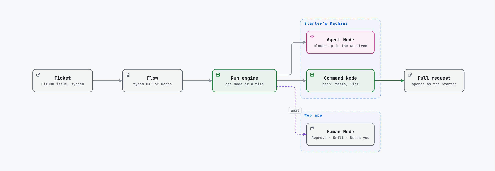
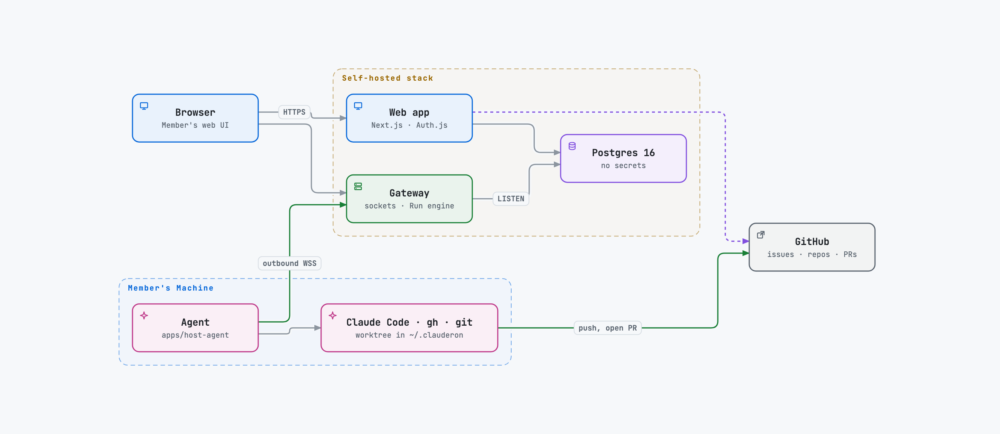

> **Not a developer?** Read the [plain-language guide](https://claude.ai/artifact/Uoah9d66hwGAi5feUGg1sK) (English and Vietnamese): what Clauderon does, how it works, and what is new in each release. This README is the technical one.

<div align="center">

# Clauderon

**Turn GitHub issues into reviewable pull requests.**
Pick issues, run each one through a configurable Flow of Claude Code, shell and human steps on your own computer, and review the result.

[](https://github.com/toinguyen-agilityio/clauderon/actions/workflows/ci.yml)


[Overview](#overview) · [How it works](#how-it-works) · [Architecture](#architecture) · [Quick start](#quick-start) · [Configuration](#environment-variables) · [Docs](#documentation)

</div>

---

## Overview

Clauderon is a shared web app for one team. Members pick GitHub issues (**Tickets**), start a **Flow** on them, and come back to pull requests. A Flow is a typed graph of steps: Claude Code agent steps, shell commands, and human steps that stop to ask a person to approve a plan or answer questions.

Each **Run** executes on the **Starter's own computer** (their paired **Machine**), under the Claude Code and `gh` logins that Member already has. The pull request is opened under the Starter's own GitHub name, and the app itself only ever reads from GitHub.

| Without Clauderon | With Clauderon |
| --- | --- |
| Each developer drives Claude Code by hand, one issue at a time | Select several Tickets, press **Start**, come back to pull requests |
| Everyone prompts differently, so results vary | Every Ticket of a kind goes through the same Flow |
| Nobody else sees what the agent did or why | Live logs, approvals, retries, token counts and an audit log, visible to the whole team |

> [!NOTE]
> Terms in **bold** (Member, Machine, Agent, Flow, Node, Run…) have precise meanings defined in the glossary, [CONTEXT.md](CONTEXT.md).

## Key features

Implemented today:

- **Machines and Pairing**: each Member installs the Agent with one command, approves a short-lived pairing code in the web app, and their computer connects out to the Gateway (no inbound ports). A **Doctor** checks tools, logins, Pairing, Gateway, service and disk, and reports to the Machine page. The Agent updates itself from the web app.
- **Projects and Tickets**: enable GitHub repositories with a base branch, then pull open issues in with a manual **Sync**.
- **Flow editor**: build Flows on a canvas from a shared **Node library**. Edges are type-checked by Output Type (`issue`, `plan`, `branch`, `test-result`, `pull-request`, `summary`, `screenshot`) and cycles are rejected. Sample Nodes and Flows are seeded; Flows can be cloned, exported to a file and imported.
- **Node kinds**: Ticket (entry), Agent (Claude Code), Command (bash), and two Human Nodes: **Approve** (approve, or reject with feedback) and **Grill** (Claude asks batches of questions that a Member answers in a form).
- **Runs**: one Run per Ticket in its own git worktree and branch. Batches, a per-Machine queue with Member-set **Slots**, **Retry** from any Node, **Cancel**, and **Interrupted** Runs when a Machine drops for 30 seconds.
- **People in the loop**: a **Needs you** inbox for every Run waiting on a person; any Member can respond to or cancel any Run.
- **Observability**: live, masked logs streamed to the browser, token counts per Run, a Runs list with filters, a Pull requests page and an audit log of every Member action.
- **Access**: Google sign-in behind an email allowlist managed by the Operator on the Members page.

## How it works

<picture>
  <source media="(prefers-color-scheme: dark)" srcset="docs/images/how-it-works-dark.png">
  
</picture>

1. **Pair a Machine.** Install the Agent and approve its pairing code. Log in to Claude Code and `gh` on that computer once.
2. **Enable a Project.** Pick a GitHub repository and its base branch, then **Sync** its open issues as Tickets.
3. **Pick a Flow.** Clone a sample (for example *Plan and deliver*) and adjust it on the canvas.
4. **Start Runs.** Select Tickets; each becomes a Run queued on your Machine. The Gateway runs the Flow's Nodes one at a time in topological order, all in the Run's worktree.
5. **Stay in the loop.** Approve plans, answer Grill questions or retry a failed Node from **Needs you** and the Run page.
6. **Review.** The Run pushes its branch and opens a pull request with your own `gh` login.

A failed or rejected Node fails the Run; there are no automatic loops. A Member retries from the Node they choose, and that Node is told the rejection feedback and why the last attempt failed ([ADR 0002](docs/adr/0002-flows-are-typed-dags-run-sequentially.md)).

## Architecture

<picture>
  <source media="(prefers-color-scheme: dark)" srcset="docs/images/architecture-dark.png">
  
</picture>

<sub>Diagrams drawn with the <code>/visual</code> skill from <a href="docs/images/readme-diagrams.json">docs/images/readme-diagrams.json</a>; edit that file and re-render to update them.</sub>

| Part | Role |
| --- | --- |
| **Web** (`apps/web`) | Next.js UI and ordinary API, Google sign-in. Serves the Agent installer and bundle at `/agent/*`. Delegates everything long-lived to the Gateway. |
| **Gateway** (`apps/gateway`) | Always-on Node service. Holds one WebSocket per paired Machine, serves Pairing and browser sockets, watches heartbeats, and runs the **Run engine**. Talks to the web app through command rows in Postgres. |
| **Agent** (`apps/host-agent`) | Runs on each Member's Machine as a user service. Connects out to the Gateway and runs Nodes as local processes in bash (Git Bash on Windows), each Run in a worktree under `~/.clauderon`. |
| **Postgres** | One database shared by web and Gateway. Holds no secrets. |

Design rules worth knowing up front:

- **The app never writes to GitHub.** All pushes and pull requests happen on the Starter's Machine under their own `gh` login ([ADR 0001](docs/adr/0001-pods-push-with-their-own-git-login.md)).
- **Runs execute on the Member's own computer, with no container or sandbox**, under their own Claude Code login ([ADR 0006](docs/adr/0006-each-member-runs-on-their-own-machine.md)).
- **The Agent ships as one esbuild bundle with its own Node 22** and updates itself to the bundle the web app serves ([ADR 0007](docs/adr/0007-the-agent-ships-as-one-bundle-with-its-own-node.md)).
- **Web and Gateway deploy and restart separately**, so protocol and schema changes must stay compatible with both.

## Screenshots and demo

There are no screenshots in the repository yet. To click through the screens, open the UI prototype in a browser: [docs/prototype/clauderon-prototype.html](docs/prototype/clauderon-prototype.html). It runs on simulated data and predates the move from Pods to Machines, so some screens differ from the app.

## Tech stack

| Area | Technology |
| --- | --- |
| Language | TypeScript (ESM) on Node.js ≥ 22 |
| Monorepo | pnpm 10 workspaces, Turborepo |
| Web | Next.js 16, React 19, Auth.js (`next-auth` v5 beta) with Google |
| Gateway and Agent | Node.js, `ws` WebSockets; Agent bundled with esbuild |
| Data | PostgreSQL 16, Drizzle ORM and Drizzle Kit migrations |
| Contracts | zod schemas in `packages/protocol` |
| Testing | Vitest against a real Postgres (no database mocks) |
| Tooling | ESLint, `tsx` |
| Deployment | Render Blueprint (`render.yaml`) in production; Docker Compose with a Cloudflare Tunnel (`cloudflared`) to self-host |
| On each Machine | Claude Code CLI, GitHub CLI (`gh`), git, bash / Git Bash |

## Project structure

```text
.
├── apps/
│   ├── web/          Next.js UI and API; serves /agent/install.sh, install.ps1, agent.mjs
│   ├── gateway/      Always-on service: Machine links, Pairing, browser sockets, Run engine
│   └── host-agent/   The Agent: pair, run, doctor, install-service (built to dist/agent.mjs)
├── packages/
│   ├── core/         Pure domain logic: Flow validation, Run state, Ticket Status, limits, masking
│   ├── db/           Drizzle schema, migrations, query modules, seed of sample Flows
│   ├── protocol/     zod message schemas between Gateway, Agent and browser
│   └── testing/      Shared fixtures and fakes for tests
├── deploy/           Production Compose stack, Dockerfile, deploy and backup scripts
├── docs/             Requirements, milestone specs, ADRs, plans, prototype
├── docker-compose.yml  Local Postgres for development and tests only
├── CONTEXT.md        Domain glossary
└── DESIGN.md         UI design notes
```

Internal packages export TypeScript source (`./src/index.ts`) and have no build step.

## Prerequisites

**To develop the app**

- Node.js 22 or later and pnpm 10 (`corepack enable` picks the version pinned in `package.json`)
- Docker, for the local Postgres
- A Google OAuth client (type *Web application*) for sign-in
- Optional: a fine-grained, **read-only** GitHub token for the repositories you want to sync

**To pair a Machine and run real Runs**

- git and the GitHub CLI (`gh`), logged in
- Claude Code (`claude`), logged in with the Member's own account
- On Windows: Git for Windows (for Git Bash)

## Quick start

These steps run the whole app locally and pair your own computer as a Machine.

**1. Install dependencies**

```bash
git clone https://github.com/toinguyen-agilityio/clauderon.git
```

```bash
cd clauderon && corepack enable && pnpm install
```

**2. Configure the environment**

```bash
cp .env.example .env
```

Fill in at least `GOOGLE_CLIENT_ID`, `GOOGLE_CLIENT_SECRET`, `SESSION_SECRET` and `OPERATOR_EMAILS` (your own Google email, so you can sign in and manage the allowlist). Generate the session secret with:

```bash
openssl rand -base64 32
```

In the Google OAuth client, add the redirect URI `http://localhost:3000/api/auth/callback/google`. To read real issues, sign in as an Operator and save a read-only GitHub token on the Projects page.

**3. Start Postgres and prepare the database**

```bash
pnpm db:up
```

The database scripts read `DATABASE_URL` from the shell, not from `.env`, so load it first. `db:seed` applies migrations and seeds the sample Nodes and Flows (`db:migrate` only migrates):

```bash
set -a && . ./.env && set +a && pnpm db:seed
```

**4. Run the web app and the Gateway**

```bash
pnpm dev
```

The web app is on <http://localhost:3000> and the Gateway on `ws://localhost:4000`. Both read the root `.env` on their own.

**5. Pair this computer and run the Agent**

In a second terminal:

```bash
pnpm --filter @clauderon/host-agent pair http://localhost:3000
```

Approve the code on the page it opens. The Agent then runs in that terminal. Check the Machine with the Doctor on its page, or run `pnpm --filter @clauderon/host-agent start doctor`.

**6. Try it**

Enable a Project, **Sync** its Tickets, clone a sample Flow, and try the Flow in the editor with **Test run** first: it steps through every Node in the browser and never calls Claude or GitHub.

> [!TIP]
> Tests need only the Postgres from step 3. Each test file creates and drops its own database: `pnpm test`.

## Environment variables

Secrets live only in the environment, never in the database. Local development reads the root `.env` (template: [.env.example](.env.example)); production reads `deploy/.env.production` (template: [deploy/.env.production.example](deploy/.env.production.example)). Neither file is committed.

### Development (`.env`)

| Variable | Used by | Required | Description |
| --- | --- | --- | --- |
| `DATABASE_URL` | web, gateway, db scripts | Yes | Postgres connection string. The template points at the local container on port 54329. |
| `TEST_DATABASE_URL` | tests | For tests | Postgres server where each test file creates and drops its own database. Defaults to the local container. |
| `GOOGLE_CLIENT_ID`, `GOOGLE_CLIENT_SECRET` | web | Yes | Google OAuth client for sign-in. |
| `SESSION_SECRET` | web, gateway | Yes | Auth.js cookie signing, Gateway tickets and the key that encrypts the app's GitHub token. Rotating it signs everyone out, and an Operator saves the GitHub token again. |
| `AUTH_URL` | web, gateway | Yes | Public origin of the web app, e.g. `http://localhost:3000`. |
| `OPERATOR_EMAILS` | web, gateway | Yes | Comma-separated emails that are always allowed and manage the allowlist. |
| `GATEWAY_URL` | web | Yes | WebSocket URL of the Gateway as browsers and Agents reach it. Default `ws://localhost:4000`. |
| `GATEWAY_PORT` | gateway | No | Port the Gateway listens on. Default `4000`. |
| `WEB_URL` | gateway | No | Public web URL for the approve links Agents open. Defaults to `AUTH_URL`. |
| `AGENT_BUNDLE_DIR` | web | No | Folder with the built `agent.mjs` and `agent.json`. Default `../host-agent/dist`. |

### Self-hosted stack (`deploy/.env.production`)

Production on Render takes its variables from `render.yaml` and the Render dashboard instead; see [deploy/README.md](deploy/README.md#production-on-render).

| Variable | Description |
| --- | --- |
| `POSTGRES_PASSWORD` | Password of the stack's Postgres container (random secret). |
| `SESSION_SECRET` | As above (random secret). |
| `GOOGLE_CLIENT_ID`, `GOOGLE_CLIENT_SECRET` | Google OAuth client; redirect URI `https://<WEB_HOSTNAME>/api/auth/callback/google`. |
| `WEB_HOSTNAME` | Public hostname of the web app, e.g. `clauderon.example.com`; `https://<WEB_HOSTNAME>` becomes `AUTH_URL` and the Gateway's `WEB_URL`. |
| `GATEWAY_HOSTNAME` | Public hostname of the Gateway; `wss://<GATEWAY_HOSTNAME>` becomes the web app's `GATEWAY_URL`. |
| `CLOUDFLARE_TUNNEL_TOKEN` | Token of the Cloudflare Tunnel that publishes both; `deploy/deploy.sh tunnel` fills it in. |
| `OPERATOR_EMAILS` | As above. |
| `WEB_HOST_PORT`, `GATEWAY_HOST_PORT` | Ports on `127.0.0.1` for checks on the host. Default `3000` and `4000`. |

<details>
<summary><strong>Agent variables</strong> (on a Member's Machine)</summary>

| Variable | Description |
| --- | --- |
| `CLAUDERON_HOME` | The Agent's own directory: Pairing, link state, clones and worktrees. Default `~/.clauderon`. |
| `CLAUDERON_BASH` | bash used for every command. On Windows, Git Bash is found where Git for Windows installs it. |
| `CLAUDERON_URL` | Web app URL for `pair` when none is passed on the command line. |
| `GATEWAY_URL` | Overrides the Gateway URL the Agent got from Pairing. |
| `CLAUDERON_WEB_URL` | Overrides the web app URL the Agent updates itself from. |
| `CLAUDERON_NO_UPDATE` | Set to turn off self-updates. |
| `CLAUDERON_NO_BROWSER` | Set to stop `pair` from opening the browser. |

The Agent also sets variables of its own for Nodes and services (such as `CLAUDERON_SERVICE` and `CLAUDERON_PATH`); they are not meant to be set by hand.

</details>

## Development commands

Run from the repository root.

| Command | What it does |
| --- | --- |
| `pnpm dev` | Web (Next.js) and Gateway in watch mode |
| `pnpm build` | Build every package that has a build (web app, Agent bundle) |
| `pnpm lint` | ESLint in every package |
| `pnpm typecheck` | `tsc --noEmit` in every package |
| `pnpm test` | Vitest in every package (needs Postgres) |
| `pnpm db:up` | Start the local Postgres 16 container on port 54329 |
| `pnpm db:migrate` | Apply Drizzle migrations (needs `DATABASE_URL` in the shell) |
| `pnpm db:seed` | Apply migrations and seed the sample Nodes and Flows |
| `pnpm --filter @clauderon/db generate` | Generate a migration after editing `packages/db/src/schema.ts` |
| `pnpm --filter @clauderon/host-agent pair <web-url>` | Pair this computer as your Machine, then run the Agent |
| `pnpm --filter @clauderon/host-agent build` | Bundle the Agent into `apps/host-agent/dist` |
| `pnpm --filter @clauderon/gateway test` | Tests of one package |
| `pnpm --filter @clauderon/core exec vitest run src/flow` | One test file or name filter |

CI runs lint, typecheck and tests against Postgres, plus the Agent's tests, its bundle build and an install smoke test ([apps/web/scripts/agent-smoke.ts](apps/web/scripts/agent-smoke.ts)) on macOS, Linux and Windows.

## Documentation

| Document | What it covers |
| --- | --- |
| [CONTEXT.md](CONTEXT.md) | Domain glossary: the words to use in code, UI and conversation |
| [docs/requirements/v1-requirements.md](docs/requirements/v1-requirements.md) | v1 scope, functional and non-functional requirements, decision log |
| [docs/specs/](docs/specs/README.md) | One spec per milestone (M0–M4): contracts, behaviour, acceptance tests, slices |
| [docs/adr/](docs/adr/) | Architecture decision records |
| [deploy/README.md](deploy/README.md) | Production deployment and operations |
| [Plain-language guide](https://claude.ai/artifact/Uoah9d66hwGAi5feUGg1sK) | Landing page for non-technical readers: features, how it works, safety, what changed in each release (EN/VI). Source: [docs/landing-page.html](docs/landing-page.html) |
| [docs/README.md](docs/README.md) · [docs/overview.md](docs/overview.md) | Docs index and one-page product brief |
| [docs/roadmap/v1-seven-day-plan.md](docs/roadmap/v1-seven-day-plan.md) | The v1 delivery plan by milestone |
| [docs/agents/](docs/agents/) | How coding agents use this repo: issue tracker, triage labels, domain docs |
| [DESIGN.md](DESIGN.md) | UI design notes |
| [CONTRIBUTING.md](CONTRIBUTING.md) | Branch, commit, pull request and release conventions |
| [CLAUDE.md](CLAUDE.md) | Guidance for Claude Code working in this repository |

<details>
<summary><strong>Architecture decision records</strong></summary>

| ADR | Decision | Status |
| --- | --- | --- |
| [0001](docs/adr/0001-pods-push-with-their-own-git-login.md) | Everything that writes to GitHub runs under the Starter's own `gh` login | Accepted (written for Pods; applies to Machines) |
| [0002](docs/adr/0002-flows-are-typed-dags-run-sequentially.md) | Flows are typed DAGs without cycles, run one Node at a time | Accepted |
| [0003](docs/adr/0003-pods-are-member-containers-on-one-pod-host.md) | Pods are per-Member Docker containers on one Pod Host | Superseded by 0006 |
| [0004](docs/adr/0004-web-app-on-vercel-with-an-always-on-gateway.md) | Web app plus an always-on Gateway | Hosting superseded by 0005; the split stands |
| [0005](docs/adr/0005-self-host-the-app-on-the-pod-host.md) | Self-host the stack with Docker Compose behind Tailscale | Accepted; partly superseded by 0006 |
| [0006](docs/adr/0006-each-member-runs-on-their-own-machine.md) | Each Member runs on their own paired Machine | Accepted |
| [0007](docs/adr/0007-the-agent-ships-as-one-bundle-with-its-own-node.md) | The Agent ships as one bundle with its own Node and a Doctor | Accepted |

</details>

> [!NOTE]
> The requirements, specs and overview were written for the earlier Pod design (one Docker container per Member on a shared Pod Host). Where they mention Pods, the Pod Host or the web terminal, ADRs 0006 and 0007 and the code take precedence.

## Security considerations

Clauderon runs an AI agent with broad permissions on people's computers. Read [ADR 0006](docs/adr/0006-each-member-runs-on-their-own-machine.md) before using it with real repositories.

- **No sandbox.** Agent Nodes run `claude` with `--dangerously-skip-permissions` and Command Nodes run bash, both with the Member's full user permissions. Each Run works in its own worktree under `~/.clauderon`, never in the Member's own checkouts, but nothing stops a Node from reaching beyond it.
- **A Google session is a remote shell.** Whoever holds a Member's signed-in session can start Runs on that Member's Machine, and anyone who can edit a Flow runs code on the Machine of every Member who starts it.
- **Prompt injection.** A malicious issue can steer the agent. Log `gh` in with a fine-grained token limited to the Projects' repositories to cap the reach.
- **Credentials stay with the Member.** The app never reads, stores or forwards Claude or OAuth tokens; the Agent only checks login status. A Machine token is stored only as its SHA-256 hash.
- **Read-only GitHub access.** The app holds one read-only token; every write to GitHub happens on the Starter's Machine.
- **Secrets in the environment only.** No secrets in the database, and known token patterns are masked before any log line is stored or streamed.
- **Network.** The app is on the internet (on Render, or through a Cloudflare Tunnel when self-hosted), so Google sign-in and the allowlist are the only gate. Machines open no inbound port, and Postgres is reachable only from the app's services.

## Contributing

Branches, commits, pull request bodies and releases are described in [CONTRIBUTING.md](CONTRIBUTING.md). Pull requests go into `staging`.
