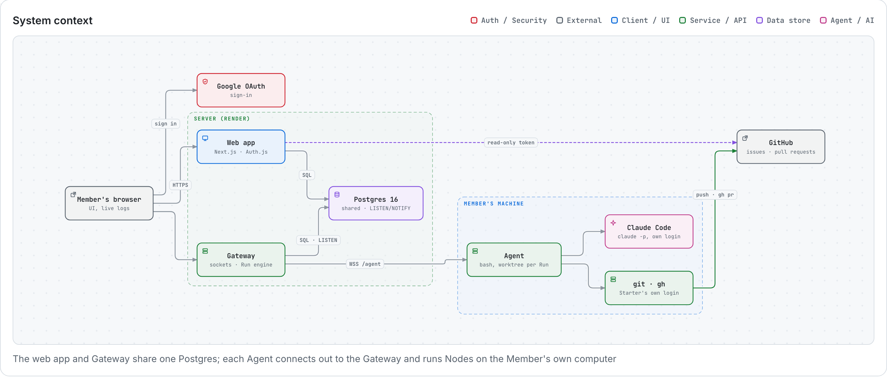
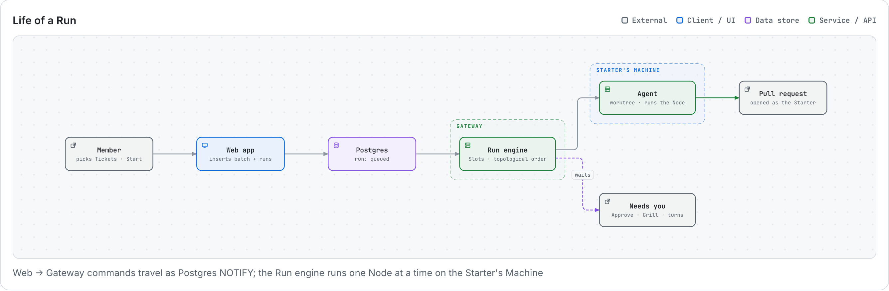

# Architecture overview

How Clauderon is built: the deployables, the packages, how a Run travels through them, and the rules that shape the code. The reasons behind each choice are in the [ADRs](adr/); the domain words (Member, Machine, Agent, Flow, Node, Run, Attempt, Starter…) are defined in [CONTEXT.md](../CONTEXT.md).

## System context

<picture>
  <source media="(prefers-color-scheme: dark)" srcset="images/system-context-dark.png">
  
</picture>

<sub>Diagrams drawn with the <code>/visual</code> skill from <a href="images/docs-diagrams.json">images/docs-diagrams.json</a>; edit that file and re-render to update them.</sub>

- The **web app** serves the UI and ordinary requests. It never holds long-lived connections.
- The **Gateway** holds one WebSocket per paired Machine and one per open browser tab, and runs the **Run engine**.
- Each **Agent** connects *out* to the Gateway (no inbound ports on the Machine) and runs Nodes as local processes.
- The app only **reads** GitHub, with one read-only token. Every push and pull request happens on the Starter's Machine under their own `gh` login ([ADR 0001](adr/0001-pods-push-with-their-own-git-login.md)).

## Components

| Component | Path | Responsibilities |
| --- | --- | --- |
| Web app | `apps/web` | Next.js 16 / React 19 UI (pages under `src/app/(app)`: tickets, runs, flows, needs-you, pull-requests, machines, projects, members, allowlist, audit). Google sign-in with Auth.js and the email allowlist. Mutations run as server actions (`src/app/(app)/actions.ts` and per-page `actions.ts`). Serves the Agent installer and bundle under `/agent/*`. Reads GitHub issues and pull requests on Sync. |
| Gateway | `apps/gateway` | Always-on Node service (`src/main.ts`). `/agent` WebSocket per Machine (`machine-link.ts`), Pairing over HTTP (`pairing.ts`), browser sockets (`browser-hub.ts`, `live-hub.ts`), heartbeat watch that marks Runs Interrupted after 30 s (`machine-watch.ts`), the Run engine (`run-engine.ts`), Flow drafts (`flow-drafts.ts`), attachment delivery (`attachments-http.ts`), daily log retention (`log-retention.ts`, 90 days). |
| Agent | `apps/host-agent` | Runs on each Member's computer as a user service (launchd, systemd user unit, or Windows `Run` key). Commands: `pair`, `run`, `doctor`, `install-service`, `uninstall-service`. Runs each Node in bash with the PATH of the Member's login shell (`tool-path.ts`), each Run in a git worktree under `~/.clauderon`, behind the `System` seam (`system.ts`). Checks Claude Code and `gh` login status only (`logins.ts`). Ships as one esbuild bundle with its own Node 22 and updates itself ([ADR 0007](adr/0007-the-agent-ships-as-one-bundle-with-its-own-node.md)). |
| `@clauderon/protocol` | `packages/protocol` | zod schemas for every message between the Gateway, the Agent and the browser, plus Pairing and Gateway tickets. The contract between deploy targets. |
| `@clauderon/core` | `packages/core` | Pure domain logic with no I/O: Flow typing and validation, Run state, Ticket Status, the editor's Test run simulator, limits, secret masking (`mask`). |
| `@clauderon/db` | `packages/db` | Drizzle schema (`src/schema.ts`), SQL migrations (`drizzle/`), per-feature query modules, the seed of sample Nodes and Flows, and `@clauderon/db/testing` (a fresh database per test file). |
| `@clauderon/features` | `packages/features` | Builds `docs/features.json` from `features.map.json` (`pnpm features:build`; CI runs `features:check`). |
| `@clauderon/testing` | `packages/testing` | Shared fixtures and fakes for tests. |

Internal packages export TypeScript source (`./src/index.ts`) and have no build step; the Gateway runs with `tsx`, and Next.js transpiles the packages.

## Folder structure

```text
.
├── apps/
│   ├── web/            Next.js app: src/app (pages, route handlers), src/server (server logic), scripts/agent-smoke.ts
│   ├── gateway/        Gateway service: src/main.ts, server.ts, run-engine.ts, machine-link.ts, …
│   └── host-agent/     The Agent: src/main.ts (CLI), nodes.ts, doctor.ts, install scripts; dist/ after build
├── packages/
│   ├── core/  db/  protocol/  features/  testing/
├── deploy/             Dockerfile, compose.yml, deploy.sh, backup.sh for the self-hosted stack
├── docs/               This documentation, ADRs, requirements, specs, generated features.json
├── render.yaml         Render Blueprint (production)
├── docker-compose.yml  Local Postgres for development and tests only
├── turbo.json          Turborepo pipeline (build, dev, lint, typecheck, test)
└── CONTEXT.md          Domain glossary
```

## Important data flows

### Sign-in and access

1. The browser signs in with Google through Auth.js (`/api/auth/*`).
2. The email must be in `OPERATOR_EMAILS` or on the allowlist (`allowlist_entry`); otherwise the Member sees `/access-denied`.
3. The session cookie's value is never stored: `session.token_hash` holds its SHA-256.
4. To open its Gateway socket, the browser fetches a 60-second HMAC ticket from `GET /api/gateway-ticket` and connects to `wss://<gateway>/browser?ticket=…`. The Gateway loads the session and checks the allowlist again.

### Pairing a Machine

1. The installer (`/agent/install.sh` or `install.ps1`) downloads Node 22 and `/agent/agent.mjs`, checks both against their SHA-256, then runs `pair`.
2. The Agent creates a random token and sends only its SHA-256 to `POST /pair` on the Gateway, which returns a short code and an approve URL.
3. The Member opens `/pair?code=…` on the web app and approves on the Machines page. The pairing's token hash becomes the Member's `machine.token_hash`.
4. The Agent polls `GET /pair/<id>` until approved, then connects to `/agent` with `Authorization: Bearer <token>`.

### A Run

<picture>
  <source media="(prefers-color-scheme: dark)" srcset="images/run-lifecycle-dark.png">
  
</picture>

1. A Member selects Tickets (or starts a Flow from an Input such as a branch, pull request, plan or summary) and presses Start. The web app inserts a `batch` and one `run` per item in state `queued`, with a snapshot of the Flow, then sends a `schedule` command to the Gateway.
2. Web → Gateway commands travel through Postgres `NOTIFY` on the `gateway_command` channel (`packages/db/src/gateway-commands.ts`): `schedule`, `run.cancel`, `run.resume`, `machine.checkLogins`, `machine.updateAgent`, `machine.repaired`, `needs.changed`, `member.notify`.
3. The Run engine starts queued Runs up to the Machine's **Slots** (default 2). It asks the Agent to prepare a worktree (`workspace.prepare`), then runs the Flow's Nodes one at a time in topological order (`node.run`), recording an `attempt` per Node.
4. The Agent streams `node.log`, `node.usage` and `node.turns`; the Gateway masks known token patterns, stores `log_chunk` rows and forwards them to subscribed browsers. `node.result` carries the Node's typed Outputs.
5. A Human Node (Approve or Grill), or an Agent Node that reached its turn limit, puts the Run in `waiting_for_human` with a `human_request`. It shows in **Needs you**; the response is a `run.resume` command.
6. A failed Node fails the Run; a Member retries from a chosen Node ([ADR 0002](adr/0002-flows-are-typed-dags-run-sequentially.md)). If the Machine's heartbeat stops for 30 seconds, running Runs become `interrupted`.
7. The final Nodes push the branch and open the pull request with the Starter's `gh` login. The web app refreshes pull request state from GitHub at most once a minute.

Run states: `queued`, `running`, `waiting_for_human`, `succeeded`, `failed`, `interrupted`, `cancelled`. A Ticket has at most one Run that is not `succeeded` or `cancelled`.

### Attachments

Files attached when starting a plan or summary Run (`POST /api/flows/{id}/start`, up to 25 MB together) are sealed with a key from `SESSION_SECRET` in `run_attachment`. The Agent fetches each once from `GET /agent/attachments/<id>` on the Gateway; the contents are then cleared ([ADR 0011](adr/0011-run-attachments-reach-the-machine-through-the-gateway.md)).

### Agent updates

The web app serves `/agent/agent.json` (version and SHA-256) and `/agent/agent.mjs`. Agents compare on (re)connect and replace themselves; `machine.updateAgent` asks one to do it now.

## Integrations

| Integration | Direction | How |
| --- | --- | --- |
| Google OAuth | web → Google | Auth.js Google provider; scopes `openid email profile` |
| GitHub (read) | web → GitHub | REST with the Operator-set, read-only token (issues, pull requests, repositories) |
| GitHub (write) | Machine → GitHub | `git push` and `gh pr create` under the Starter's own login |
| Claude Code | Machine | `claude -p` under the Member's own login; tokens are never read or forwarded |
| Render / Cloudflare | hosting | See the [deployment guide](deployment.md) |

## Rules that shape the code

- A Flow is a DAG with typed edges and no cycles; Nodes run one at a time; there are no automatic retries ([ADR 0002](adr/0002-flows-are-typed-dags-run-sequentially.md)).
- Runs execute on the Starter's own Machine, with no container or sandbox ([ADR 0006](adr/0006-each-member-runs-on-their-own-machine.md)).
- No secrets in the database in the clear; a Machine token is stored only as its SHA-256 hash; logs are masked before they are stored or streamed.
- Web and Gateway deploy and restart separately, so protocol messages and the schema must stay compatible with both versions during a deploy. An unknown message type is ignored, not an error (`packages/protocol/src/envelope.ts`).
