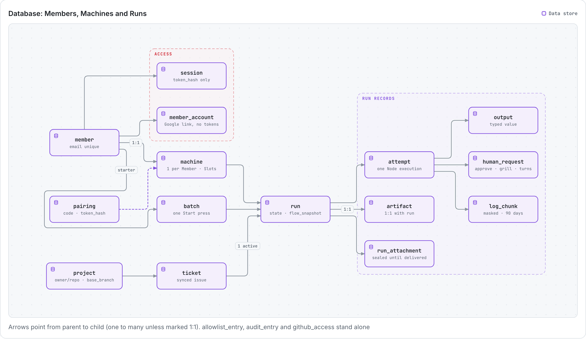
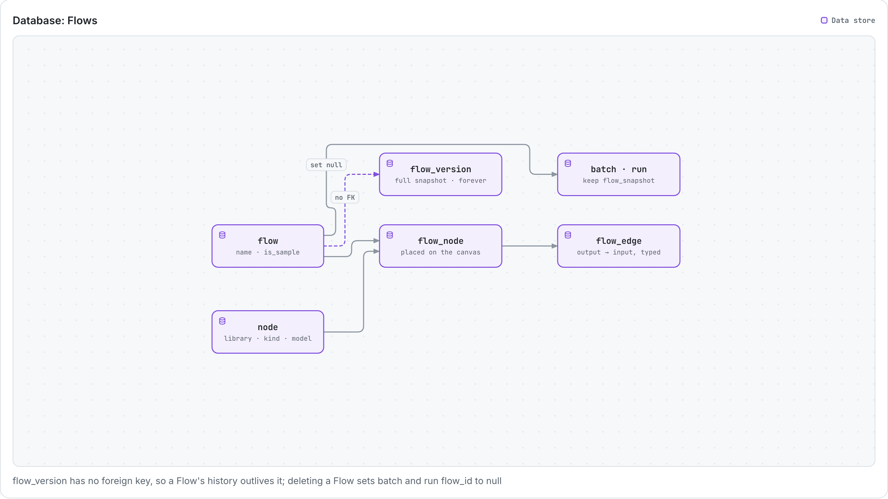

# Database schema and migration guide

Clauderon uses one PostgreSQL 16 database, shared by the web app and the Gateway. The schema is defined with Drizzle ORM in [`packages/db/src/schema.ts`](../packages/db/src/schema.ts) (the source of truth) and migrated with plain SQL files generated by Drizzle Kit in [`packages/db/drizzle/`](../packages/db/drizzle).

The database holds **no secrets in the clear**: session cookies and Machine tokens are stored only as SHA-256 hashes, OAuth and Claude tokens are never stored, and the app's GitHub token and Run attachments are encrypted with a key derived from `SESSION_SECRET`.

## Entity relationships

<picture>
  <source media="(prefers-color-scheme: dark)" srcset="images/database-runs-dark.png">
  
</picture>

<picture>
  <source media="(prefers-color-scheme: dark)" srcset="images/database-flows-dark.png">
  
</picture>

<sub>Diagrams drawn with the <code>/visual</code> skill from <a href="images/docs-diagrams.json">images/docs-diagrams.json</a>; edit that file and re-render to update them.</sub>

## Tables

### Access

| Table | Purpose | Key fields |
| --- | --- | --- |
| `member` | A person who signed in | `email` (unique), `name`, `picture_url`, `last_sign_in_at` |
| `member_account` | Links a Google account to a Member for Auth.js; no tokens | PK (`provider`, `provider_account_id`), `member_id` |
| `allowlist_entry` | Emails allowed to sign in, besides `OPERATOR_EMAILS` | `email` (PK), `added_by_email`, `added_at` |
| `session` | A signed-in session | `token_hash` (SHA-256 of the cookie, unique), `member_id`, `expires_at`, `ended_at` |
| `audit_entry` | Every Member action | `actor_email`, `action`, `subject_type`, `subject_id`, `detail` (jsonb), `at` (indexed) |

### Machines

| Table | Purpose | Key fields |
| --- | --- | --- |
| `machine` | One per Member (`member_id` unique) | `token_hash` (null = not paired), `paired_at`, facts from the Agent's `hello` (`hostname`, `os`, `arch`, `agent_version`, `cpus`, `memory_mb`, `disk_gb`), `connected`, `last_heartbeat_at`, `usage` (jsonb), `slots` (default 2), login status (`claude_logged_in`, `gh_logged_in`, `gh_account`, `claude_account`, `claude_plan`, `gh_token_scope`), `doctor` (jsonb report), link counters `last_received_id` / `last_sent_id` |
| `pairing` | A code an Agent is showing | `code` (unique), `token_hash` (unique), `hostname`, `os`, `arch`, `expires_at` (10 minutes), `approved_at`, `approved_by_member_id` |

Pairing a new computer replaces `machine.token_hash`, so the Machine row, its Runs and its Slots stay.

### Projects and Tickets

| Table | Purpose | Key fields |
| --- | --- | --- |
| `github_access` | The app's one read-only GitHub token (at most one row, `singleton` check) | `token_sealed` (AES-256-GCM), `token_last4`, `login`, `set_by_email`, `set_at` |
| `project` | An enabled repository | unique (`owner`, `repo`), `base_branch`, `last_synced_at`, `sync_summary`, `sync_error` |
| `ticket` | A synced GitHub issue | unique (`project_id`, `number`), `title`, `body`, `labels`, `issue_state`, `url`, `synced_at` |

### Flows

| Table | Purpose | Key fields |
| --- | --- | --- |
| `node` | Node library entry | `kind` (enum `node_kind`: `ticket`, `input`, `agent`, `command`, `approve`, `grill`), `instructions`, `command`, `inputs` / `outputs` (jsonb, typed), `model`, `max_turns`, `slug` (seeded samples), `is_sample` |
| `flow` | A Flow | `name`, `slug`, `is_sample`, `cloned_from_id` |
| `flow_node` | A Node placed on a Flow's canvas | `flow_id` (cascade), `node_id`, `label`, `extra_instructions`, `enabled_optional_outputs`, `x`, `y` |
| `flow_edge` | A typed edge | `from_flow_node_id` + `from_output` → `to_flow_node_id` + `to_input` |
| `flow_version` | Full masked snapshot per change, kept forever ([ADR 0012](adr/0012-flow-history-is-a-full-snapshot-per-change-kept-forever.md)) | unique (`flow_id`, `seq`), `kind`, `actor_email`, `snapshot`, `summary`, `detail` |

### Runs

| Table | Purpose | Key fields |
| --- | --- | --- |
| `batch` | One Start press | `flow_id` (set null), `starter_member_id`, `extra_instructions` |
| `run` | One Ticket (or Input) through one Flow | `state` (enum `run_state`), `flow_snapshot`, `ticket_id` or `project_id` (check: one of them), `input_value`, `machine_id`, `branch`, `worktree_path`, pull request fields, `failure_reason`, `pending_retry` |
| `attempt` | One execution of one Node in a Run | `flow_node_id`, `number`, `state` (enum `attempt_state`), `exit_code`, `error`, token counts, `turns`, `claude_session_id`, `retry_context`, `superseded` |
| `output` | A typed Output of an Attempt | `name`, `type`, `value` (jsonb) |
| `human_request` | An Approve, Grill or turn-limit request | `kind` (enum: `approve`, `grill`, `turns`), `round`, `questions`, `response`, `responded_by_email` |
| `log_chunk` | Masked log lines | index (`attempt_id`, `seq`), `stream` (`stdout`, `stderr`, `system`), `text`; deleted after 90 days |
| `artifact` | One per Run | `content` (jsonb) |
| `run_attachment` | A file attached at start | unique (`run_id`, `name`), `size`, `sha256`, `sealed` (bytea, cleared once delivered), `delivered_at` |

Important constraints:

- `run_one_active_per_ticket_idx`: a Ticket has at most one Run whose state is not `succeeded` or `cancelled`.
- `run_machine_queue_idx` on (`machine_id`, `state`, `queued_at`) serves the per-Machine queue.
- Deleting a Flow keeps its Runs (foreign keys `set null`); Runs keep their `flow_snapshot`.

## Retention

The Gateway deletes `log_chunk` rows older than 90 days once a day (`apps/gateway/src/log-retention.ts`). Runs, Outputs and Artifacts are kept.

## Migration workflow

Migrations are forward-only SQL files applied in order by Drizzle's migrator (`packages/db/src/migrate.ts`), which records applied files in Drizzle's journal table. There are no down migrations.

1. Edit [`packages/db/src/schema.ts`](../packages/db/src/schema.ts).
2. Generate the SQL (needs `DATABASE_URL` in the shell):

   ```bash
   pnpm --filter @clauderon/db generate
   ```

   This writes `packages/db/drizzle/NNNN_<name>.sql` and updates `drizzle/meta/`. Review the SQL by hand; rename the file to say what it does, as the existing ones do (`0019_node_model_turn_limit.sql`), and keep `meta/_journal.json` in step.
3. Apply it locally:

   ```bash
   set -a && . ./.env && set +a && pnpm db:migrate
   ```

4. Run the tests: each test file migrates a fresh database, so `pnpm test` exercises every migration.
5. Commit the schema change, the SQL file and `meta/` together.

**Keep changes compatible.** Web and Gateway deploy and restart separately, and the Gateway runs the migrations before it starts, so for a short time the old web app runs against the new schema. Add columns as nullable or with a default, and remove or rename in a later release once no running code reads the old shape (the Pods → Machines move did this in three steps: `0005_machines_add`, `0006_machines_copy_pods`, `0007_machines_drop_pods`). Data migrations go in the SQL file too (e.g. `0013_ticket_node_to_input.sql`).

### Where migrations run

| Environment | How |
| --- | --- |
| Local | `pnpm db:migrate` or `pnpm db:seed` (migrate, then seed samples) |
| Tests | `@clauderon/db/testing` creates a database per test file and migrates it |
| Render | `pnpm start:gateway` = `pnpm db:migrate`, then the Gateway (free services have no pre-deploy step) |
| Self-hosted Compose | the one-shot `migrate` service; the Gateway starts only after it succeeds |

## Seeding

`pnpm db:seed` applies migrations, then upserts the sample Nodes and Flows by their `slug` (`packages/db/src/seed.ts`), so running it again updates the samples.

## Backup and rollback

- **Self-hosted:** `deploy/backup.sh install` dumps Postgres daily at 03:00 and keeps 14 days in `deploy/backups/` (or `BACKUP_DIR`); `deploy/backup.sh` takes one now; `deploy/backup.sh restore <file.dump>` stops web and Gateway, replaces the database and starts them again. See [deploy/README.md](../deploy/README.md#7-backups).
- **Render (current production):** the free Postgres plan has **no backups** and expires after 30 days. Take a manual dump before any release with a risky migration, using the External Database URL from the Render dashboard. `render.yaml` sets `ipAllowList: []`, which blocks every outside connection, so add your own IP to the database's access control in the dashboard for the dump and remove it afterwards:

  ```bash
  pg_dump --format=custom --no-owner --file "clauderon-$(date +%Y%m%d-%H%M).dump" "$RENDER_EXTERNAL_DATABASE_URL"
  ```

- **Rolling back a migration:** there are no down migrations. Either write a new forward migration that undoes the change, or restore the dump taken before the release (data written since is lost). Rolling back only the code (redeploying an older commit) is safe when the migration was additive, because the old code ignores new nullable columns.

See the [deployment guide](deployment.md#rollback) for the full release rollback procedure.
