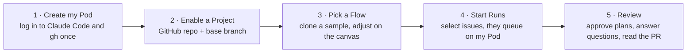
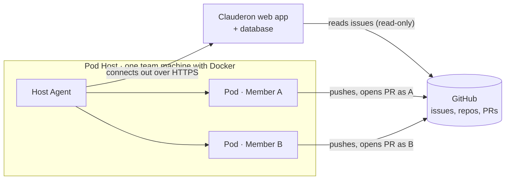

# Clauderon at a glance

> **A one-page brief for leads and newcomers.** Read this in five minutes; follow the links for detail.
> **Status:** v1 requirements settled (2026-11-13) · no design or code yet · **Source of truth:** [v1 requirements](requirements/v1-requirements.md)

---

## In one sentence

**Clauderon turns GitHub issues into reviewable pull requests**: the team picks issues, runs them through a repeatable workflow, and Claude Code does the work in each member's own sandbox, stopping to ask a person when a decision is needed.

## Why

| Today | With Clauderon |
| --- | --- |
| Each developer drives Claude Code by hand, one issue at a time, at their desk | Pick several issues, press **Start**, come back to pull requests |
| Every person prompts differently, so results vary | Every issue of a kind goes through the same **Flow** |
| Nobody else sees what the agent did, what it cost, or why | Live logs, approvals, token usage and a summary for every run, visible to the whole team |

## How it works

A typical Flow: **issue → plan → a person approves → code → test → pull request**.

## The four building blocks

| Block | What it is |
| --- | --- |
| **Pod** | A member's personal Docker container on one shared team machine, holding their own Claude Code and GitHub logins |
| **Ticket** | An open GitHub issue, pulled in with a **Sync** button |
| **Flow** | A workflow drawn as a graph of steps: an AI agent step, a shell command, or a human step (approve, or answer Claude's questions) |
| **Run** | One Flow applied to one Ticket on the starter's Pod; it ends with a branch, a pull request and a summary |

## Architecture in brief

Three choices worth knowing:

- **The app never writes to GitHub.** Pull requests are opened from each member's Pod under their own GitHub name, so ownership stays clear ([ADR 0001](adr/0001-pods-push-with-their-own-git-login.md)).
- **One container per member** on a single team machine, each with its own logins, storage and CPU/RAM limits ([ADR 0003](adr/0003-pods-are-member-containers-on-one-pod-host.md)).
- **Flows are simple graphs** with no loops, run one step at a time, with typed connections that are checked in the editor ([ADR 0002](adr/0002-flows-are-typed-dags-run-sequentially.md)).

## What v1 includes, and what it leaves out

| In v1 | Not in v1 |
| --- | --- |
| One team, sign-in with Google for allowlisted emails | Other sign-in methods, roles, multiple teams |
| GitHub Issues and GitHub repositories | Jira, GitLab, other agents than Claude Code |
| Personal Pods on one team machine | Several machines, shared Pods, VMs |
| Flow editor with sample Flows to clone | Loops, parallel steps, Flow versions |
| Batches, queue, approvals, retry, cancel, dry-run | Automatic sync or auto-start on new issues |
| Live logs, diff, token usage, a summary per Run | Comments or label changes on GitHub issues |

## How we will know it works

- **Goals:** hands-off (issue to PR without someone driving the agent), repeatable (same Flow every time), visible (who, what, cost, result).
- **Measures, targets set after M2:** share of Runs ending in a merged PR · median time from Start to PR · Tickets run per week.

## Roadmap

No fixed dates; each milestone ends when its check passes.

| Milestone | Delivers |
| --- | --- |
| **M0** Model and seed | Data model, storage, sample Flows, Google sign-in |
| **M1** Walking skeleton | First real issue → real pull request on a member's Pod |
| **M2** Flows and scheduling | Flow editor, a Pod per member, queue, batches, dry-run |
| **M3** People in the loop | Approve and Q&A steps, "Needs you" inbox, retry, cancel, audit |
| **M4** Refinement | Usage, summaries, diff, Pod lifecycle and health |

## Top risks

| Risk | Mitigation |
| --- | --- |
| **Company policy** on company repos, personal Claude subscriptions and bot-like pull requests | Ask IT and leads before M1; fall back to a sandbox repo |
| **Broad credentials:** a malicious issue could steer the agent with the member's full GitHub access | Fine-grained GitHub tokens scoped to the project repos |
| **Stolen session:** whoever holds a member's Google session can use their Pod | Allowlist, expiring sessions, every action audited |
| **One machine** hosts every Pod, so it is a single point of failure | UPS and wired network; interrupted runs are retried by hand |

## Decisions we need from leads

1. **Approval to use company repositories** and personal Claude subscriptions on Pods (risk above).
2. **Where to host** the web app and its database, and who can reach it.
3. **The Pod Host machine:** how many Pods it must hold, and whether the Docker Desktop licence applies to us.

## Learn more

| If you want… | Read |
| --- | --- |
| Every requirement, decision and open question | [v1 requirements](requirements/v1-requirements.md) |
| To click through the screens | [UI prototype](prototype/clauderon-prototype.html) (open in a browser) |
| The reasoning behind key design choices | [Architecture decision records](adr/) |
| The exact meaning of each term | [Glossary (CONTEXT.md)](../CONTEXT.md) |
