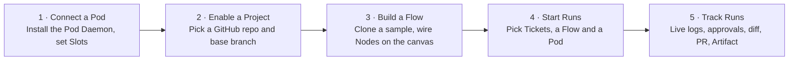
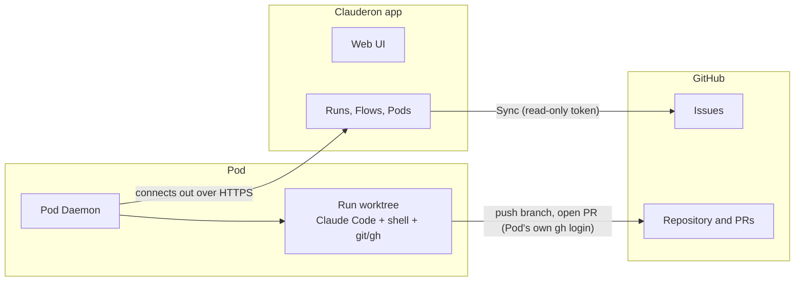
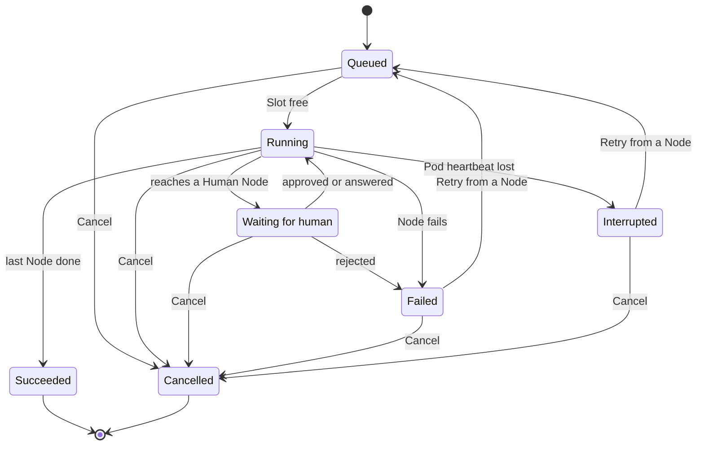

# Clauderon — Requirements v1 (final)

> **Version:** v1 final · **Date:** 2026-11-12 · **Status:** Requirements settled; no technical design or code yet.
> **Sources:** merges two earlier drafts, [docs/requirements/v1-requirements.md](../v1-requirements.md) (team draft) and `docs/requirements-v1.md` on the `docs/requirements-v1` branch of `toinguyen-agilityio/clauderon` (practice draft), following the practice draft's outline. Every point where they differed was settled on 2026-11-12; see [section 9](#9-decision-log-2026-11-12).
> **Supersedes:** both drafts. They stay in the repo for history only.
> **Next step:** design, then spec, then implementation plan (section 12).

---

## 1. Overview

**Clauderon** is a self-hosted web app that lets one team run GitHub issues through Flows on the team's own machines (Pods). Claude Code, shell commands and people work through each Ticket and leave a branch, a pull request, logs and an Artifact behind. It has four modules:

- **Pods**: machines the team already owns. A Pod Daemon on each one connects out to the app and runs Nodes in a git worktree per Run.
- **Flows**: directed acyclic graphs drawn on a canvas. Each Node uses a Task, an Agent, Command or Human step with typed inputs and Outputs.
- **Tickets**: open GitHub issues of a Project, pulled in with a **Sync** button.
- **Runs**: one Flow applied to one Ticket on one Pod. Runs can stop and wait for a person (Approve, Grill).

**How the team uses it:**

**Use case:** a team member clones the sample Flow "ticket → plan → approve → code → test → PR", picks a few Tickets, starts them as a Batch on a Pod, answers Claude's questions and approves the plan, then reads each Run's Artifact and reviews the pull request on GitHub.

**How the pieces connect:**

The app never connects into a Pod and never writes to GitHub. Everything that writes to GitHub happens on the Pod.

---

## 2. Goals and success measures

### Goals

1. **Hands-off:** turn a GitHub issue into a reviewable pull request without a person driving the agent.
2. **Repeatable:** every Ticket of a kind goes through the same Flow.
3. **Visible:** anyone can see who started a Run, what each Node did, what it cost in tokens and time, and what it produced.

### Success measures

Product measures (targets to set after M2):

| # | Measure |
| --- | --- |
| S1 | Share of Runs that end in a merged pull request |
| S2 | Median time from Start to pull request opened |
| S3 | Tickets run per week |

Acceptance checks:

| # | Check | How to verify |
| --- | --- | --- |
| A1 | One real Ticket runs through the sample Flow and its Run shows a link to a real pull request | Live demo |
| A2 | 10 Tickets started as a Dry-run Batch on a Pod with 2 Slots never run more than 2 at once; the rest stay Queued and start first-in, first-out | Automated test plus demo |
| A3 | The Flow editor rejects an edge whose Output Type does not match the input, and rejects any cycle | Unit tests of the validator |
| A4 | Each Run shows the correct state of every Node: queued, running, waiting for human, succeeded, failed | Manual script plus runner unit tests |
| A5 | Reloading the page or restarting the app loses no Pods, Flows, Runs or logs | Manual check |

---

## 3. Scope

### In scope

- **People:** one team on one self-hosted instance. A member signs in by typing a username, with no verification.
- **Projects:** each Project is one GitHub repository and its base branch. Several Projects can be enabled.
- **Pods:** several Pods per instance, each with a Pod Daemon, Slots, heartbeat, measured CPU, RAM and disk use, and forwarded-port metadata.
- **Tickets:** open GitHub issues pulled in with a manual **Sync**, with a list, search, filter, a detail view and multi-select to start Runs.
- **Flows:** a canvas editor for directed acyclic graphs. Edges are type-checked by Output Type and cycles are rejected. Sample Tasks and Flows are seeded, and members clone them to edit.
- **Runs:** Batches, a queue per Pod, Human Nodes (Approve, Grill), Retry from any Node, Cancel, Dry-run, live logs, usage per Node and an Artifact per Run.
- **Real runner:** Claude Code and shell commands on the Pod, one git worktree per Run, a real branch and pull request pushed with the Pod's own git/gh login.

### Out of scope

- Real authentication (GitHub OAuth, SSO), roles and permissions, multiple teams, billing.
- Ticket sources other than GitHub Issues, and code hosts other than GitHub.
- Agents other than Claude Code.
- Provisioning Pods from the app (containers, VMs), real port forwarding, Tailscale.
- Automatic issue sync (polling, webhooks) and starting Runs automatically when a Ticket appears.
- Writing to GitHub from the app: changing issue state or labels, commenting on issues.
- Cycles in a Flow, Loop-backs, Skip Conditions, parallel execution of Nodes within a Run.
- Flow versioning.
- Default Flow per Project, and Built-in versus Project Task sources.
- Pod Environment managed by the app (variables and secrets live on the Pod itself).
- A Run that changes several repositories.

---

## 4. Functional requirements

Priority: **Must** / **Should** / **Could**.

### 4.1 Members and Projects

| ID | Requirement | Priority |
| --- | --- | --- |
| MEM-1 | Sign in by typing a username; the app remembers it in the browser and shows it on every action the member takes. | Must |
| MEM-2 | Every member can do everything: start, approve, reject, answer, cancel and retry any Run. | Must |
| PRJ-1 | Enable a GitHub repository as a Project, with its base branch. | Must |
| PRJ-2 | Store one read-only GitHub token for the app (Issues and Pull requests read), encrypted at rest. | Must |

### 4.2 Pods

| ID | Requirement | Priority |
| --- | --- | --- |
| POD-1 | The Pod Daemon connects out to the app over HTTPS; the Pod needs no inbound port or SSH ([ADR 0001](../../adr/0001-pods-connect-out-via-daemon.md)). | Must |
| POD-2 | Register a Pod with a name and a number of Slots (default 2), and pair its Pod Daemon with the app. | Must |
| POD-3 | Running Runs on a Pod never exceed its Slots; extra Runs wait in that Pod's queue and start first-in, first-out. | Must |
| POD-4 | Show each Pod's status (`online` / `offline`, from the Pod Daemon's heartbeat), last heartbeat time, Slots in use, and its running and queued Runs. | Must |
| POD-5 | An `offline` Pod starts nothing; its queue waits until it is back or its Runs are moved. | Must |
| POD-6 | Remove a Pod; refused while it has Active Runs. | Should |
| POD-7 | Show measured CPU, RAM and disk use reported by the Pod Daemon. | Could |
| POD-8 | Forwarded-port metadata: port, label, access level `private` / `internet+sign-in` / `public`, with a red warning for `public`. Metadata only. | Could |
| POD-9 | The Pod's own git and gh login is used for every push and pull request; the Pod page shows which GitHub account that is ([ADR 0003](../../adr/0003-pods-push-with-their-own-git-login.md)). | Must |

### 4.3 Tickets

| ID | Requirement | Priority |
| --- | --- | --- |
| TIC-1 | Ticket list per Project: key (`ledger-api#412`), title, labels, Ticket status. | Must |
| TIC-2 | Search by title or key; filter by Project and Ticket status. | Should |
| TIC-3 | Select several Tickets → **Start** (see RUN-1). | Must |
| TIC-4 | Ticket detail: issue body from GitHub, every Run of the Ticket, links to their pull requests and Artifacts. | Should |
| TIC-5 | **Sync** button pulls the open issues of a Project from GitHub. Sync never starts a Run. | Must |
| TIC-6 | Ticket status is derived, never stored: `Open` (no Active Run), `Queued`, `In run`, `Needs you` (waiting for human), `Failed`, `Interrupted`, `PR open`, `PR merged`, `Closed` (issue closed on GitHub). | Must |
| TIC-7 | A Ticket has at most one Active Run. Dry-run Runs do not count. | Must |
| TIC-8 | The app never changes issue state or labels and never comments on issues; pull requests reference the issue with `Refs #<n>`. | Must |

### 4.4 Flows

| ID | Requirement | Priority |
| --- | --- | --- |
| FLW-1 | Task library: each Task has a name, a kind (Agent, Command, Human), instructions or a command, typed inputs and typed Outputs. | Must |
| FLW-2 | Human Tasks come in two kinds: **Approve** (Approve / Reject with feedback) and **Grill** (Claude asks, a member answers, Claude continues in the same session until it produces its Output). | Must |
| FLW-3 | Canvas editor: drag Tasks in as Nodes, connect an Output to an input. | Must |
| FLW-4 | An edge is allowed only when the Output Type matches the input; a mismatch shows an error on the edge. | Must |
| FLW-5 | Validate before saving: exactly one entry Node (takes the `issue`), at least one end Node, no cycles, no required input left unconnected. A Flow with problems shows an "N problems" badge and cannot start Runs. | Must |
| FLW-6 | Node panel: name, extra instructions for this Node, optional Outputs on or off. | Must |
| FLW-7 | A Flow cannot be edited while any Active Run (Dry-run included) uses it. There are no Flow versions. | Must |
| FLW-8 | Seed sample Tasks (`Grill a plan`, `Approve a plan`, `Code a change`, `Run tests`, `Open a pull request`) and sample Flows (`Basic ticket delivery`, `Plan and deliver`). Samples are read-only; members **clone** them to edit. | Must |

Output Types for v1: `issue`, `plan`, `branch`, `test-result`, `pull-request`, `summary`, `screenshot`.

### 4.5 Runs

| ID | Requirement | Priority |
| --- | --- | --- |
| RUN-1 | Start dialog: pick a Flow, the Tickets, one Pod for the whole Batch, optional extra instructions, and mode `Real` / `Dry-run`. One Run per Ticket; Runs started together form a Batch. | Must |
| RUN-2 | A Run executes its Nodes **one at a time** in topological order, each Node once all its required inputs exist. | Must |
| RUN-3 | Each Run has its own git worktree and branch on the Pod; all Nodes of the Run share that worktree. | Must |
| RUN-4 | A Human Node puts the Run in `waiting for human`. The Run keeps its Slot and there is no timeout. | Must |
| RUN-5 | **Needs you** queue: every Node waiting for a person, across all Runs, in one place. | Must |
| RUN-6 | Reject (Approve kind) fails the Node and the Run becomes `Failed`, keeping the feedback. | Must |
| RUN-7 | **Retry** from any Node of a `Failed` or `Interrupted` Run: that Node and everything after it run again as new Attempts; the latest Reject feedback is passed to the retried Node. Earlier Attempts' Outputs and logs stay visible. | Must |
| RUN-8 | **Cancel** ends any Active Run (Queued, Running, Waiting for human, Failed, Interrupted) as `Cancelled`. | Must |
| RUN-9 | A `Failed` or `Interrupted` Run stays Active until it is retried to success or cancelled: it keeps the Ticket's single Active Run and the Flow's edit lock, but not a Slot. | Must |
| RUN-10 | Real runner: Agent Nodes run Claude Code headless on the Pod with the subscription signed in there; Command Nodes run a shell command; output streams to the browser. | Must |
| RUN-11 | The `Open a pull request` Task pushes the branch and opens the pull request with the Pod's gh login, only when there are changes. The body says who started the Run and includes `Refs #<n>`. | Must |
| RUN-12 | Pod heartbeat lost: running Runs become `Interrupted`; queued Runs on that Pod can be moved to another Pod. | Should |
| RUN-13 | Dry-run: a simulated runner (each Node 2–8 s, configurable failure rate, fake Outputs such as `branch: feat/412-retry`, `pr: #88`). It occupies a Slot and locks the Flow but does not count toward the Ticket's Active Run and never touches GitHub or Claude. Dry-run Runs are clearly marked. | Must |
| RUN-14 | The worktree is deleted when a Run ends as `Succeeded` or `Cancelled`; it is kept while the Run is `Failed` or `Interrupted`. | Should |
| RUN-15 | Every action on a Run (start, approve, reject, answer, cancel, retry, move) records the username and time. | Should |

**Run lifecycle:**

A Run holds a Slot only while Running or Waiting for human.

### 4.6 Tracking

| ID | Requirement | Priority |
| --- | --- | --- |
| TRK-1 | Run page: timeline of Nodes with state, duration and live log; logs kept after the Run ends. | Must |
| TRK-2 | Each Node's Outputs, per Attempt. | Must |
| TRK-3 | Diff of the Run's branch and the pull request link. | Must |
| TRK-4 | Usage: tokens and duration per Node, and totals per Run, taken from what Claude Code reports. | Should |
| TRK-5 | **Artifact:** when a Run ends, it gets one Artifact summarising its work: what changed, how to test it, screenshots, the pull request link. Shown on the Run page and written into the pull request body. | Should |
| TRK-6 | Batch page: each Run of a Batch with its state, current Node and pull request. | Should |
| TRK-7 | Runs list: Ticket, Flow, mode, state, Starter, times; filter by state, Flow and Pod. | Must |

### 4.7 Non-functional requirements

| ID | Area | Requirement | Priority |
| --- | --- | --- | --- |
| NFR-1 | Security | The app's GitHub token is encrypted at rest; tokens and secrets are masked in every log the app stores or shows. | Must |
| NFR-2 | Audit | See RUN-15. | Should |
| NFR-3 | Resilience | The Pod Daemon reconnects by itself after a network drop. | Must |
| NFR-4 | Latency | Node output reaches the browser within a few seconds. | Should |
| NFR-5 | Durability | Flows, Runs and logs survive app restarts and are backed up; log retention to set. | Should |

### 4.8 Screens

| Screen | Shows | Main actions |
| --- | --- | --- |
| Sign in | Username field | Enter the app |
| Projects | Enabled repositories | Enable a repo, set base branch, Sync |
| Tickets | Tickets per Project with derived status | Search, filter, select, Start |
| Start dialog | Flow, Pod, mode, extra instructions, selected Tickets | Start the Batch |
| Flows | Flow list, Task library, canvas editor with problems badge | Clone a sample, add Nodes, connect Outputs, save |
| Pods | Pod list and detail: status, heartbeat, Slots, queue, health, ports, gh account | Register, set Slots, move queued Runs, remove |
| Runs | Runs list with filters | Open a Run |
| Run | Node timeline, live logs, Outputs per Attempt, diff, PR, usage, Artifact | Approve, reject, answer, retry from a Node, cancel |
| Batch | Runs of one Batch | Open a Run |
| Needs you | Every Node waiting for a person | Approve, reject, answer |

---

## 5. Constraints and assumptions

### Constraints

- No fixed deadline; work is delivered milestone by milestone (section 7).
- Claude Code runs on each Pod under the subscription signed in there, so it is limited by that subscription's quota.
- Company repositories may be used; see risk R1.

### Assumptions

- Pods run Linux or macOS with git, gh and the Claude Code CLI installed and signed in.
- Pods reach the app and GitHub over outbound HTTPS. The app needs no public URL.
- Claude Code runs headless, can resume a session (for Grill), and reports output and token usage as it goes.
- The username sign-in is trusted: anyone can type any name. Usernames are for display and audit, not security.
- Tech stack is undecided (the practice draft suggested React, TypeScript, Vite, React Flow, Zustand and Vitest for the UI).

---

## 6. Risks

| # | Risk | Level | Mitigation |
| --- | --- | --- | --- |
| R1 | **Company policy:** company repositories, personal Claude subscriptions on Pods and a bot-like account opening pull requests | High | Ask IT and leads before M1. Fallback: a sandbox repository |
| R2 | **Broad Pod credentials:** an issue's text reaches the agent's prompt, and the Pod's gh login can usually reach many repositories, so a malicious issue could steer the agent beyond the Project | High | Use a dedicated GitHub account per Pod with access only to the Projects' repositories; show it on the Pod page (POD-9) |
| R3 | **Anthropic terms** for running Claude Code headless on a subscription from a separate app | Medium | Check the official terms during design. Fallback: an API key on the Pod |
| R4 | Subscription quota runs out mid-Run | Medium | The Node fails with a clear reason and can be retried; load-test with Dry-run |
| R5 | A Node waiting for a person holds a Slot indefinitely | Medium | Needs you queue; any member can answer or cancel |
| R6 | Usernames can be spoofed, so the audit trail is advisory | Low | Accepted for v1; real sign-in is out of scope |

---

## 7. Roadmap

Proposed split for the team to confirm. No dates: each milestone ends when its check passes.

| Milestone | Delivers | Check |
| --- | --- | --- |
| **M0 — Model and seed** | Domain model, persistence, seeded Tasks and Flows, username sign-in | Model unit tests pass; A5 |
| **M1 — Walking skeleton** | One Pod with its Pod Daemon, one Project, Sync, a fixed sample Flow with Agent and Command Nodes, live logs, real branch and pull request | A1 |
| **M2 — Flows and scheduling** | Canvas editor and validator, clone samples, Flow edit lock, several Pods, Slots and queue, Batches, Dry-run | A2, A3 |
| **M3 — People in the loop** | Approve and Grill Nodes, Needs you, Retry from any Node, Cancel, Attempts, audit | A4 |
| **M4 — Refinement** | Usage, Artifact, diff, Batch page, Interrupted and moving queued Runs, Pod health, port metadata, worktree cleanup | Demo of the full journey |

**If time is short, cut in this order:** POD-8 → POD-7 → TRK-4 → TRK-6 → RUN-12 → the Grill kind in FLW-2.

---

## 8. Open questions

1. How is the Pod Daemon installed and paired with the app (one-time token, install script)?
2. How is the Artifact produced: assembled from Node Outputs, written by a final Agent Node, or both? How are screenshots captured?
3. Is the Output Type list in 4.4 complete for the sample Flows?
4. Should each Pod use a dedicated GitHub account (see R2), and who owns it?
5. Can cost be shown in money when Claude Code runs on a subscription, or only as tokens?
6. Default number of Slots, log retention and backup schedule.
7. Tech stack and hosting for the app.

---

## 9. Decision log (2026-11-12)

How each difference between the two drafts was settled. "Team" is the team draft, "Practice" is the practice draft.

| Topic | Decision | Follows |
| --- | --- | --- |
| Purpose | A product the team uses, not a practice exercise | Team |
| People | One team; sign in by typing a username, no verification | New |
| Who can approve or cancel | Any member; actions are recorded with the username | New |
| Timeline | No fixed deadline; milestones | Team |
| GitHub writes | The Pod pushes and opens pull requests with its own git/gh login | New ([ADR 0003](../../adr/0003-pods-push-with-their-own-git-login.md), supersedes ADR 0002) |
| GitHub reads | The app holds one read-only token for issues and pull requests | New |
| Issue comments | None; the app never writes to GitHub | Practice |
| Ticket sync | Manual Sync button only | Practice |
| Ticket status | Derived from Runs, the pull request and the issue | New |
| One Active Run per Ticket | Yes; Dry-run excluded | Team |
| Pods | Several Pods, each with a Pod Daemon that connects out | Team |
| Pod Environment | Dropped; the Pod's own environment is used | New |
| Pod health and ports | Measured CPU, RAM, disk; forwarded-port metadata | Practice |
| Heartbeat and Interrupted | Kept | Team |
| Flow shape | Typed DAG on a canvas, no cycles | Practice ([ADR 0004](../../adr/0004-flows-are-typed-dags-run-sequentially.md)) |
| Node execution | One Node at a time, in topological order | New |
| Node kinds | Tasks of kind Agent, Command or Human; Human is Approve or Grill | Merged |
| Grill | Resume the same Claude session | New |
| Reject | Fails the Node; the member retries by hand | Practice |
| Retry | From any Node, with the Reject feedback | New |
| Failed Run | Stays Active until retried or cancelled | New |
| Cancel | One action ends any Active Run | New |
| Approval timeout | None; the Run keeps its Slot | Team |
| Flow versions | None; a Flow is locked while an Active Run uses it | New |
| Task and Flow library | Seeded samples, cloned to edit; no Default Flow, no Skip Conditions | Practice, trimmed |
| Dry-run | Option at Start; occupies a Slot, does not block the Ticket | Practice |
| Worktree cleanup | When a Run ends as Succeeded or Cancelled | New |
| Batch | Kept, with a Batch page | Team |
| Artifact | One summary per Run: changes, how to test, screenshots, PR link | New |
| Terms | Node (not Step), Attempt, Output and Output Type | Practice |
| NFRs | Token security, audit, reconnect, latency; durability as Should | Team, trimmed |

---

## 10. Glossary

The full glossary is [CONTEXT.md](../../../CONTEXT.md). Key terms:

| Term | Meaning |
| --- | --- |
| Project | One GitHub repository enabled in the app, with its base branch |
| Ticket | An open GitHub issue in a Project, pulled in by Sync |
| Pod | A machine the team owns where Runs execute |
| Pod Daemon | The process on a Pod that connects out to the app and runs Nodes |
| Slot | One unit of a Pod's capacity; one running Run each |
| Task | A reusable step definition: kind, instructions, typed inputs and Outputs |
| Flow | A directed acyclic graph of Nodes that a Ticket goes through |
| Node | One use of a Task inside a Flow |
| Output / Output Type | A typed value a Node produces and later Nodes consume |
| Run | One Flow applied to one Ticket on one Pod |
| Attempt | One execution of a Node in a Run; Retry creates a new one |
| Artifact | The summary of a Run's work, produced when it ends |
| Batch | The Runs started together in one action |
| Dry-run | A Run using the simulated runner |

---

## 11. Related documents

- [CONTEXT.md](../../../CONTEXT.md): domain glossary
- [docs/adr/](../../adr/): architecture decision records
- [Team draft](../v1-requirements.md) and the practice draft (`docs/requirements-v1.md` on the `docs/requirements-v1` branch of `toinguyen-agilityio/clauderon`): superseded, kept for history
- [Brainstorm notes and prototype](../../brainstorm/)

## 12. Next steps

1. Answer open questions 1, 2 and 4, and settle risk R1 with IT and leads.
2. Design part by part: data model → run engine and scheduler → Human Nodes (Approve, Grill) → Pod Daemon protocol → GitHub integration → error handling → testing.
3. Choose the tech stack.
4. Write the spec, review it, then the implementation plan.
