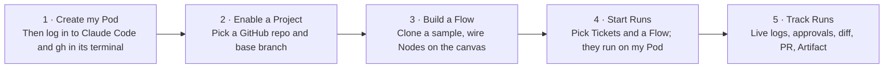
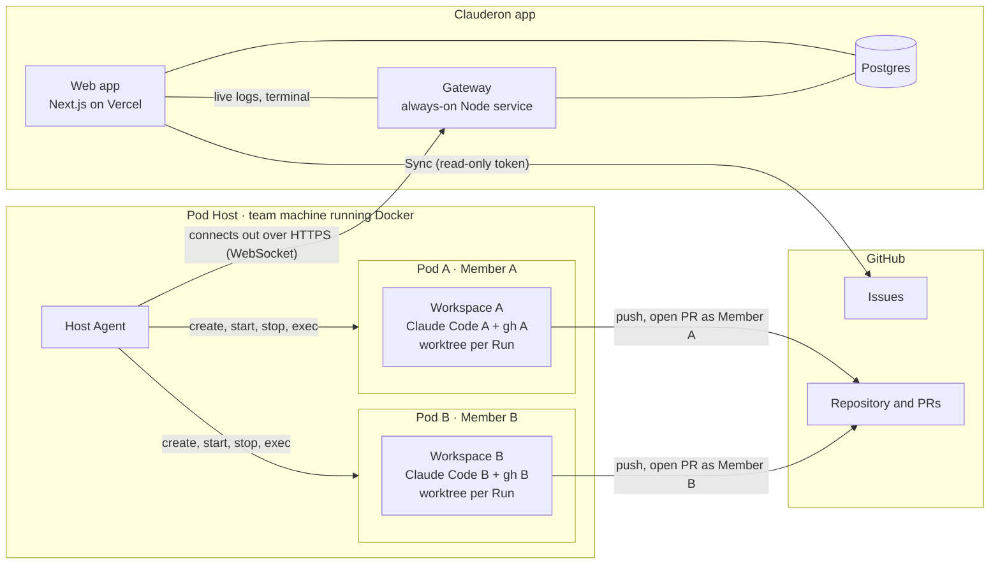
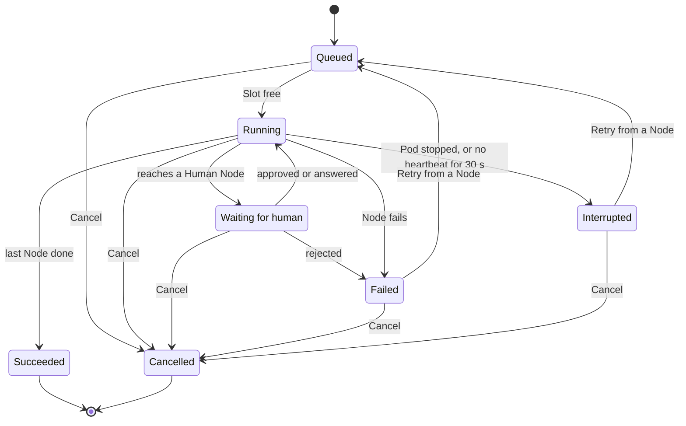

# Clauderon — Requirements v1 (final)

> **Pods to Machines (2026-11-20):** written for Pods (one Docker container per Member on a Pod Host). Pods and the Host Agent are replaced by each Member's own Machine and the Agent ([ADR 0006](../adr/0006-each-member-runs-on-their-own-machine.md), [ADR 0007](../adr/0007-the-agent-ships-as-one-bundle-with-its-own-node.md)). Read Pod as Machine, Pod Host as the Member's computer, Host Agent as Agent. Where this disagrees with the ADRs or the code, they win. M4 is already updated. **Dropped in M4 (not in v1):** TRK-3 (Diff), TRK-5 (Artifact), TRK-6 (Batch page) and TIC-4 (Ticket detail) were not built (#39, #40, `wontfix`); the pull request on GitHub and the Runs and Pull requests tabs take their place. See [the M4 spec](../specs/m4-refinement-and-release.md).

> **Version:** v1 final · **Date:** 2026-11-12, updated 2026-11-13 (Pods are per-Member Docker containers on one Pod Host; sign-in with Google) and 2026-11-16 (answers to the spec questions) · **Status:** Requirements and spec decisions settled; no code yet.
> **Sources:** merges two earlier drafts, a team draft and a practice draft, following the practice draft's outline; every point where they differed was settled on 2026-11-12. The 47 spec questions and the review of their answers ([PR #3](https://github.com/toinguyen-agilityio/clauderon/pull/3)) were settled on 2026-11-16. See [section 9](#9-decision-log).
> **Next step:** review the [milestone specs](../specs/README.md), then publish each as a GitHub issue (section 12).

---

## 1. Overview

**Clauderon** is a shared web app with its own database that lets one team run GitHub issues through Flows on personal Pods: Docker containers, one per Member, on a single team machine (the Pod Host). Claude Code, shell commands and people work through each Ticket and leave a branch, a pull request, logs and an Artifact behind. It has four modules:

- **Pods**: one Docker container per Member on the Pod Host, built from one standard Ubuntu image, holding that Member's Claude Code and gh logins in its own Workspace. A Host Agent on the Pod Host connects out to the app and runs Nodes in a git worktree per Run.
- **Flows**: directed acyclic graphs drawn on a canvas. Each Node is an Agent, Command or Human step with typed inputs and Outputs, taken from the Node library.
- **Tickets**: open GitHub issues of a Project, pulled in with a **Sync** button.
- **Runs**: one Flow applied to one Ticket on one Pod. Runs can stop and wait for a person (Approve, Grill).

**How the team uses it:**

**Use case:** a team member creates their Pod and logs in to Claude Code and gh once, clones the sample Flow "ticket → plan → approve → code → test → PR", picks a few Tickets and starts them as a Batch on their Pod, answers Claude's questions and approves the plan, then reads each Run's Artifact and reviews the pull request on GitHub.

**How the pieces connect:**

The app has two parts ([ADR 0004](../adr/0004-web-app-on-vercel-with-an-always-on-gateway.md)): the **web app** (Next.js on Vercel) serves the UI and the ordinary API, and the **Gateway** (an always-on Node service) holds every long-lived connection and runs the Runs. The app never connects into the Pod Host and never writes to GitHub. Everything that writes to GitHub happens inside the Starter's Pod, under the Starter's own gh login.

---

## 2. Goals and success measures

### Goals

1. **Hands-off:** turn a GitHub issue into a reviewable pull request without a person driving the agent.
2. **Repeatable:** every Ticket of a kind goes through the same Flow.
3. **Visible:** anyone can see who started a Run, what each Node did, what it cost in tokens and time, and what it produced.

### Success measures

Product measures (targets to set after M2):

| # | Measure |
| --- | --- |
| S1 | Share of Runs that end in a merged pull request |
| S2 | Median time from Start to pull request opened |
| S3 | Tickets run per week |

Acceptance checks:

| # | Check | How to verify |
| --- | --- | --- |
| A1 | One real Ticket runs through the sample Flow and its Run shows a link to a real pull request | Live demo |
| A2 | 10 Tickets started as a Batch on a Pod with 2 Slots never run more than 2 at once; the rest stay Queued and start first-in, first-out | Automated Gateway test with a fake Agent that holds Nodes open (the simulated Run mode that used to carry this check was removed: ADR 0009) |
| A6 | Two Members each create a Pod on the Pod Host, log in to their own Claude Code and gh, and each opens a pull request under their own GitHub name | Live demo |
| A3 | The Flow editor rejects an edge whose Output Type does not match the input, and rejects any cycle | Unit tests of the validator |
| A4 | Each Run shows the correct state of every Node: queued, running, waiting for human, succeeded, failed | Manual script plus runner unit tests |
| A5 | Reloading the page or restarting the app loses no Pods, Flows, Runs or logs; a Run that was Running when the Gateway restarted keeps running if the Host Agent reconnects within 30 seconds | Manual check |
| A7 | An allowlisted Google account signs in and its email shows on its actions; a Google account not on the allowlist is refused; the Operator removes an email on the Members page and that Member's session, open terminal and live connections end at once | Manual check |

---

## 3. Scope

### In scope

- **People:** one team on one shared web app with its own database. A member signs in with their Google account; only email addresses on the app's allowlist get in. Every member sees the team on a Members page; the Operator adds and removes members there.
- **Projects:** each Project is one GitHub repository and its base branch. Several Projects can be enabled, of any owners the app's token reads (organisations or users).
- **Pod Host:** exactly one team machine running Docker (for example Docker Desktop on an ARM64 Mac), always on, with one Host Agent that connects out to the Gateway.
- **Pods:** one Docker container per Member on the Pod Host, created, started, stopped, recreated and deleted from the app; one standard Ubuntu image; a Workspace volume per Pod; Slots and CPU/RAM limits; a web terminal for the owner to log in to Claude Code and gh; measured CPU, RAM and disk use.
- **Tickets:** open GitHub issues pulled in with a manual **Sync**, with a list, search, filter, a detail view and multi-select to start Runs.
- **Flows:** a canvas editor for directed acyclic graphs of Nodes from the Node library. Edges are type-checked by Output Type and cycles are rejected. Sample Nodes and Flows are seeded, and members clone them to edit.
- **Runs:** Batches, a queue per Pod, Human Nodes (Approve, Grill), Retry from any Node, Cancel, live logs, usage per Node and an Artifact per Run.
- **Real runner:** Claude Code and shell commands in the Starter's Pod, one git worktree per Run in its Workspace, a real branch and pull request pushed with the Starter's own gh login.

### Out of scope

- Sign-in methods other than Google (password, GitHub OAuth, other SSO), roles and permissions other than the Operator, multiple teams, billing.
- Ticket sources other than GitHub Issues, and code hosts other than GitHub.
- Agents other than Claude Code.
- More than one Pod Host; Pods on machines other than the Pod Host; VMs.
- Pods shared by several Members, or running a Run on someone else's Pod; moving a Run to another Pod.
- Forwarded ports from Pods, Tailscale, opening the Pod Host to inbound connections.
- An image per Project; automatic recreation of Pods when the image changes.
- Automatic Retry after a Pod or the Host Agent comes back.
- Automatic issue sync (polling, webhooks) and starting Runs automatically when a Ticket appears.
- Writing to GitHub from the app: changing issue state or labels, commenting on issues.
- Cycles in a Flow, Loop-backs, Skip Conditions, parallel execution of Nodes within a Run.
- Flow versioning.
- Default Flow per Project, and Built-in versus Project Node sources.
- Pod Environment managed by the app (variables and secrets live in the Pod's Workspace).
- Restricting a Pod's outbound network (accepted risk R2, POD-13).
- A Run that changes several repositories.

---

## 4. Functional requirements

Priority: **Must** / **Should** / **Could**.

### 4.1 Members and Projects

| ID | Requirement | Priority |
| --- | --- | --- |
| MEM-1 | Sign in with Google, through an OAuth client in the company's Google Cloud project managed by the team lead. Only verified Google email addresses on the allowlist can sign in; any other address sees an "access denied" page. A Member is identified by that email, shown by the Google name and picture, and named on every action they take. A session lasts 24 hours. Sign out ends the session. | Must |
| MEM-3 | The allowlist is stored in the database and holds exact email addresses only, never a whole domain, compared case-insensitively. The **Operator** emails, set in the app's configuration, are always allowed, so the Operator cannot be locked out. The first sign-in of an allowed email creates the Member. Every request and every open WebSocket and terminal connection checks the session's email against the allowlist, so removing an email takes effect at once. Removing an email also removes the Member's Machine ([ADR 0006](../adr/0006-each-member-runs-on-their-own-machine.md)), so its Agent is disconnected and its token stops working, and is refused while that Machine has Active Runs; the Member's Runs and audit entries are kept. | Must |
| MEM-4 | **Members page**, readable by every Member: each allowed email with the Member's name and picture, status (Active once signed in, Invited until then, Removed while a removed Member's Machine is left), Operator tag, last sign-in, Machine status and Active Runs. Only the Operator adds an email, removes one (behind a confirm that warns the Machine is removed too, with a link to the blocking Runs when refused), and removes another Member's Machine. Every change is recorded in the audit log. The old Allowlist address redirects here. | Must |
| MEM-2 | Every member can approve, reject, answer, cancel and retry any Run. Starting a Run and opening a Pod's terminal are tied to the Member's own Pod (POD-3, POD-9). | Must |
| PRJ-1 | The **Operator** enables a GitHub repository as a Project by picking it from the repositories the app's token can read, then choosing its base branch from the repository's branches. Every Member reads and Syncs the Projects. | Must |
| PRJ-2 | One fine-grained personal access token for the app, with Issues: read and Pull requests: read on the Projects' repositories, set by an Operator on the Projects page and stored only encrypted (ADR 0010). Projects may belong to any owner the token reads; a fine-grained token reads one owner's repositories, so Projects of several owners need a token that reads them all. | Must |
| PRJ-3 | The **Operator** removes a Project behind a confirm: its Tickets and their Runs (logs and Outputs included) are deleted from the app, nothing changes on GitHub, and the removal is recorded in the audit log. Refused while the Project has Active Runs. | Should |

### 4.2 Pods

| ID | Requirement | Priority |
| --- | --- | --- |
| POD-1 | One Pod Host: the Host Agent on it connects out to the Gateway over HTTPS and carries out every Pod and Run command; the Pod Host needs no inbound port ([ADR 0003](../adr/0003-pods-are-member-containers-on-one-pod-host.md)). An install script sets the Host Agent up as a service that starts with the Pod Host (launchd on macOS, systemd on Linux); it authenticates with a long-lived secret held in the app's configuration. | Must |
| POD-2 | **Create my Pod**: a Member without a Pod creates one Docker container from the standard image, with a Workspace volume, 2 Slots, 2 CPU and 4 GB RAM by default. The owner may change Slots, CPU and RAM up to a ceiling set in the app's configuration. A Member has at most one Pod. When the Pods' limits add up to more than the Pod Host has, the Pods page warns but creation is not refused. | Must |
| POD-3 | Every Run runs on its Starter's Pod. Running Runs never exceed the Pod's Slots; extra Runs wait in that Pod's queue and start first-in, first-out. | Must |
| POD-4 | Pods page: a Pod Host card (Host Agent connected or not, Docker running, architecture, total CPU, RAM and disk, and the Pods' total limits) containing every Pod with its owner, status, image, Claude Code and gh login state, gh account and the repositories its token reaches, Slots in use and queue. | Must |
| POD-5 | **Pod Ready** means the container is running and Claude Code and gh are logged in. Start is refused while the Starter has no Pod or its Claude Code or gh login is missing, with a link to the terminal. The Host Agent checks both logins (`gh auth status` and a Claude Code status check, plus the gh account and the token's scope) when the Pod starts, when a terminal session closes, right before each Real Run, and when the owner presses **Refresh**; there is no periodic check. Login state is shown with the time of the last check. A stopped Pod with both logins accepts Runs; they wait in its queue until it starts. | Must |
| POD-6 | The owner can Start, Stop and **Recreate** their Pod. Recreate replaces the container with the current image and keeps the Workspace. The app's configuration names the current image tag; the Host Agent pulls it and compares its digest with each Pod's image, and the Pod shows when a newer image is available. Slots change at once and apply from the next scheduling (Running Runs are not stopped); CPU and RAM apply at the next Recreate. Stop and Recreate are refused while the Pod has Running or Waiting Runs. | Must |
| POD-7 | **Delete Pod** removes the container and its Workspace, logins included; refused while the Pod has Active Runs. | Should |
| POD-8 | Show measured CPU, RAM and disk use per Pod. | Could |
| POD-9 | Web terminal into the Pod, for its owner only (the signed-in Member whose Pod it is), to log in to Claude Code and gh and to inspect the Workspace. It runs browser ↔ Gateway (WebSocket, xterm.js) ↔ Host Agent ↔ `docker exec` with a TTY. The audit log records who opened each session and when it started and ended, never the keystrokes, because logging in means typing secrets. | Must |
| POD-10 | The Workspace keeps the Member's Claude Code and gh logins, one clone per Project and one git worktree per Run; it survives Stop and Recreate. The first Real Run of a Project on a Pod clones it with the Starter's gh login; later Runs only fetch the base branch and add a worktree. | Must |
| POD-11 | Pushes and pull requests use the Starter's own gh login in their Pod, so pull requests carry the Starter's GitHub name ([ADR 0001](../adr/0001-pods-push-with-their-own-git-login.md)). The gh login must use a fine-grained token limited to the Projects' repositories. | Must |
| POD-12 | **Agent permissions:** Claude Code in Agent and Grill Nodes runs with its permission prompts skipped, because nobody is there to approve each action; the container is the boundary. Claude Code runs as a non-root user in the image. A Flow cannot change this. | Must |
| POD-13 | **Pod network:** v1 does not restrict a Pod's outbound network. This is an accepted risk (R2), limited by POD-11 and TIC-9. | Must |
| POD-14 | **Standard image:** built from a Dockerfile in this repository by CI for arm64 and amd64, with git, gh, Node LTS, Python 3, build tools and the Claude Code CLI, and a non-root user. Whoever owns the Host Agent also owns the image. | Must |

### 4.3 Tickets

| ID | Requirement | Priority |
| --- | --- | --- |
| TIC-1 | Ticket list per Project: key, title, labels, Ticket status. The key uses the repository name (`ledger-api#412`); when two Projects share a repository name, both show `owner/repo#n`. | Must |
| TIC-2 | Search by title or key; filter by Project and Ticket status. | Should |
| TIC-3 | Select several Tickets → **Start** (see RUN-1). | Must |
| TIC-4 | Ticket detail: issue body from GitHub, every Run of the Ticket, links to their pull requests and Artifacts. | Should |
| TIC-5 | **Sync**, in the background after the Tickets page opens, pulls every open issue of a Project from GitHub, and the current state of every known Ticket (so an issue closed on GitHub shows `Closed`) and of every pull request opened by a Run. Sync never starts a Run. | Must |
| TIC-6 | Ticket status is derived, never stored: `Open` (no Active Run), `Queued`, `In run`, `Needs you` (waiting for human), `Failed`, `Interrupted`, `PR open`, `PR merged`, `Closed` (issue closed on GitHub). Pull request state is read at Sync and whenever a Ticket, Run or Batch page opens. | Must |
| TIC-7 | A Ticket has at most one Active Run. | Must |
| TIC-8 | The app never changes issue state or labels and never comments on issues; pull requests reference the issue with `Refs #<n>`. | Must |
| TIC-9 | Sync records the issue author's association with the repository. The Start dialog warns when a selected Ticket's author is not an `OWNER`, `MEMBER` or `COLLABORATOR`, because its text goes straight into the agent's prompt (R2). The warning does not block Start. | Must |

### 4.4 Flows

| ID | Requirement | Priority |
| --- | --- | --- |
| FLW-1 | **Node library:** each Node has a name, a kind (Agent, Command, Human, or an Input entry Node), instructions or a command, typed inputs (each required or optional) and typed Outputs (each always produced or optional). | Must |
| FLW-2 | Human Nodes come in two kinds. **Approve**: Approve, or Reject with feedback; an Approve Node passes its input through as an Output of the same Output Type. **Grill**: in each round Claude asks a batch of questions, one Member answers them all in one form, and Claude resumes the same Claude Code session; it may ask another round until it produces its Outputs. There is no limit on rounds; any Member can Cancel the Run. | Must |
| FLW-3 | Canvas editor: drag Nodes from the library onto the Flow, connect an Output to an input. | Must |
| FLW-4 | An edge is allowed only when the Output Type matches the input; a mismatch shows an error on the edge. | Must |
| FLW-5 | Validate before saving: exactly one Input Node (the entry, typed `issue`, `branch`, `pull-request`, `plan` or `summary`; an `issue` Input emits the Ticket, the others what the Starter gives at Start, in a Run with no Ticket), at least one end Node, no cycles, no required input left unconnected. A Flow with problems shows an "N problems" badge and cannot start Runs. | Must |
| FLW-6 | Node panel, for a Node placed in a Flow: its name, extra instructions for this Flow, optional Outputs on or off. | Must |
| FLW-7 | A Flow cannot be edited or deleted while any Active Run uses it; it can still be viewed and cloned, and the editor shows which Run holds the lock. There are no Flow versions. | Must |
| FLW-8 | Seed the sample Nodes and Flows below. Samples are edited and deleted like any Flow or Node (still subject to FLW-7 and FLW-10) and can be cloned. Seeding again only adds the samples that are missing; it never overwrites a Member's changes. | Must |
| FLW-9 | Any Member can create a new Flow (it starts with the Ticket Input Node placed) and edit or delete any Flow or library Node, samples included; every change is recorded in the audit log. | Must |
| FLW-10 | A library Node cannot be edited while a Flow that uses it is locked. Editing a library Node changes every Flow that uses it. | Must |

Output Types for v1: `issue`, `plan`, `branch`, `test-result`, `pull-request`, `summary`, `screenshot`.

Sample Nodes (FLW-8); optional inputs and Outputs are marked *opt*:

| Node | Kind | Inputs | Outputs |
| --- | --- | --- | --- |
| Ticket | Input | — | `issue` |
| Branch | Input | — | `branch` |
| Pull request | Input | — | `pull-request` |
| Plan | Input | — | `plan` |
| Summary | Input | — | `summary` |
| Grill a plan | Human (Grill) | `issue` | `plan` |
| Draft a plan | Agent | `issue` | `plan` |
| Approve a plan | Human (Approve) | `plan` | `plan` |
| Code a change | Agent | `issue` *opt*, `plan` *opt* (at least one) | `branch`, `summary` *opt* |
| Run tests | Command | `branch` | `test-result` |
| Capture screenshots | Command | `branch` | `screenshot` |
| Open a pull request | Command | `branch`, `test-result` *opt*, `summary` *opt* | `pull-request` |
| Approve the pull request | Human (Approve) | `pull-request` | `pull-request` |

Sample Flows (FLW-8):

- **Basic ticket delivery:** Ticket → Code a change → Run tests → Open a pull request. It uses Agent and Command Nodes only, so it is the fixed Flow of M1.
- **Plan and deliver:** Ticket → Grill a plan → Approve a plan → Code a change (also fed the `issue`) → Run tests and Capture screenshots → Open a pull request → Approve the pull request.

### 4.5 Runs

| ID | Requirement | Priority |
| --- | --- | --- |
| RUN-1 | Start dialog: pick a Flow, the Tickets, optional extra instructions. The Batch always runs on the Starter's Pod, shown with its Slots and queue. One Run per Ticket; Runs started together form a Batch. | Must |
| RUN-2 | A Run executes its Nodes **one at a time** in topological order, each Node once all its required inputs exist. The Gateway keeps all Run state in the database and asks the Host Agent to run one Node at a time; the Host Agent only executes and reports. | Must |
| RUN-3 | Each Run has its own git worktree and branch in the Starter's Workspace; all Nodes of the Run share that worktree. The branch is named `clauderon/<issue-number>-<short-title-slug>-<short-run-id>`. | Must |
| RUN-4 | A Human Node puts the Run in `waiting for human`. The Run keeps its Slot and there is no timeout. | Must |
| RUN-5 | **Needs you** queue: every Node waiting for a person, across all Runs, in one place. | Must |
| RUN-6 | Reject (Approve kind) fails the Node and the Run becomes `Failed`, keeping the feedback. | Must |
| RUN-7 | **Retry** from any Node of a `Failed` or `Interrupted` Run: that Node and everything after it run again as new Attempts, and the Run joins the end of its Pod's queue like a new Run. The worktree is kept as it is, not reset. The retried Node receives (a) the Run's latest Reject feedback, under the heading "Feedback from the last review"; (b) why the failed Node failed: its exit code and last log lines (the last 200 lines for a Command Node); (c) an optional note the Member types in the Retry dialog. Earlier Attempts' Outputs and logs stay visible. | Must |
| RUN-8 | **Cancel** ends any Active Run (Queued, Running, Waiting for human, Failed, Interrupted) as `Cancelled`. | Must |
| RUN-9 | A `Failed` or `Interrupted` Run stays Active until it is retried to success or cancelled: it keeps the Ticket's single Active Run and the Flow's edit lock, but not a Slot. | Must |
| RUN-10 | Real runner: Agent Nodes run Claude Code headless in the Starter's Pod with the Starter's own subscription, under POD-12; Command Nodes run a shell command there; output streams to the browser through the Host Agent and the Gateway. **Agent and Grill Nodes share one result contract:** the prompt asks Claude Code to end with a structured JSON result, which names each Output or, for a Grill Node, holds the next batch of questions instead. The app checks the result against the Node's Output Types and fails the Node when a required Output is missing. **Command Nodes:** exit code 0 succeeds and anything else fails; a `test-result` Output holds the exit code and the last 200 lines of output; a `branch` Output is the Run's branch at its current commit. | Must |
| RUN-11 | The `Open a pull request` Node pushes the branch and opens the pull request with the Starter's gh login. When a pull request already exists for the branch (after a Retry), it pushes the new commits and reuses that pull request. When there are no changes, it succeeds without a `pull-request` Output and logs "no changes"; the Run can still succeed and the Ticket stays `Open`. The body includes `Refs #<n>`. | Must |
| RUN-12 | The Host Agent sends a heartbeat every 10 seconds over one WebSocket whose messages carry ids, so both sides resume after a reconnect. **A drop under 30 seconds** while the Host Agent keeps running: the connection resumes from the message ids, nothing is killed and Runs stay Running. **30 seconds without a heartbeat, or a Host Agent restart**, or a Pod that stops or crashes: the Pod's Running Runs become `Interrupted`; on reconnect the Host Agent kills orphaned Node processes, meaning processes of Interrupted Runs and processes it no longer holds a handle for. **A Gateway restart or deploy** is handled the same way, since Run state is in the database: if the Host Agent reconnects within 30 seconds, Runs keep running. Runs waiting for a person keep their state; Queued Runs wait for the Pod to run again. Nothing is retried automatically. | Must |
| RUN-13 | _Removed_ (ADR 0009): the Dry-run Run mode overlapped with the editor's Test run and cost code and rules across the Gateway, web app and database. The editor's Test run (FLW-3) stays. The queue and Slots are checked by a Gateway test with a fake Agent (A2). | Dropped |
| RUN-14 | The worktree is deleted when a Run ends as `Succeeded` or `Cancelled`; it is kept while the Run is `Failed` or `Interrupted`. | Should |
| RUN-15 | Every action on a Run (start, approve, reject, answer, cancel, retry), every Pod action (create, start, stop, recreate, delete, terminal session), every Flow and library Node change and every allowlist change records the Member's email and time. | Should |
| RUN-16 | A Run succeeds when every Node it reaches succeeds. An optional Output that is not produced does not fail the Run. | Must |

**Run lifecycle:**

A Run holds a Slot only while Running or Waiting for human.

### 4.6 Tracking

| ID | Requirement | Priority |
| --- | --- | --- |
| TRK-1 | Run page: timeline of Nodes with state, duration and live log; logs kept after the Run ends (NFR-5). | Must |
| TRK-2 | Each Node's Outputs, per Attempt. | Must |
| TRK-3 | Diff of the Run's branch and the pull request link. | Must |
| TRK-4 | Usage: tokens and duration per Node, and totals per Run, taken from what Claude Code reports. No cost in money is shown. | Should |
| TRK-5 | **Artifact:** when a Run ends, the app assembles one Artifact from the Run's Outputs: the `summary` (what changed, how to test it), every `screenshot`, the diff statistics and the `pull-request` link. There is no built-in screenshot capture; a Node must produce `screenshot` Outputs. The Artifact is shown on the Run page and, as a last system step outside the Flow, the Gateway asks the Host Agent to write it into the pull request body with the Starter's gh login in the Pod, so the app itself still never writes to GitHub. | Should |
| TRK-6 | Batch page: each Run of a Batch with its state, current Node and pull request. | Should |
| TRK-7 | Runs list: Ticket, Flow, mode, state, Starter, times; filter by state, Flow and Pod. | Must |

### 4.7 Non-functional requirements

| ID | Area | Requirement | Priority |
| --- | --- | --- | --- |
| NFR-1 | Security | The Google OAuth client secret and the Host Agent secret live in the app's configuration, never in the database; the app's GitHub token is stored only encrypted with a key from the configuration (ADR 0010). Before any log line is stored or streamed, the Host Agent and the app mask known token patterns (GitHub, Anthropic, OAuth) and the values of known secrets. Sign-in sessions use secure, HTTP-only cookies and expire (MEM-1). | Must |
| NFR-2 | Audit | See RUN-15. | Should |
| NFR-3 | Resilience | The Host Agent reconnects by itself after a network drop or a Pod Host restart, and resumes from message ids (RUN-12). | Must |
| NFR-6 | Isolation | Each Pod has its own container, Workspace volume and CPU/RAM limits, so one Member's Runs cannot read another Member's Workspace or starve the Pod Host. | Must |
| NFR-4 | Latency | Node output reaches the browser within a few seconds. | Should |
| NFR-5 | Durability | Flows, Runs and logs survive app restarts. Logs are stored in Postgres in chunks per Attempt and deleted after 90 days; Runs, Outputs and Artifacts are kept. The database is backed up daily and each backup is kept 14 days. | Should |

### 4.8 Screens

| Screen | Shows | Main actions |
| --- | --- | --- |
| Sign in | Sign in with Google button; access denied page for emails not on the allowlist | Sign in, sign out |
| Members | Every allowed email with name, status, Operator tag, last sign-in, Machine and Active Runs (every Member reads it) | Operator: add an email, remove one (removes the Machine too), remove a Member's Machine |
| Projects | Enabled repositories | Sync; Operator: enable a repo from the token's list and pick its base branch, remove a Project |
| Tickets | Tickets per Project with derived status | Search, filter, select, Start |
| Start dialog | Flow, mode, extra instructions, selected Tickets with author warnings, the Starter's Pod with its Slots | Start the Batch |
| Flows | Flow list, Node library, canvas editor with problems badge and lock holder | Clone a sample, add Nodes, connect Outputs, save |
| Pods | Pod Host card with every Pod and total limits; Pod detail: owner, status, image, Claude Code and gh login state with last check, gh account and token scope, Slots, queue, health | Create my Pod, start, stop, recreate, delete, set Slots and limits, Refresh |
| Pod terminal | A shell in the owner's Pod | Log in to Claude Code and gh, inspect the Workspace |
| Runs | Runs list with filters | Open a Run |
| Run | Node timeline, live logs, Outputs per Attempt, diff, PR, usage, Artifact | Approve, reject, answer, retry from a Node with a note, cancel |
| Batch | Runs of one Batch | Open a Run |
| Needs you | Every Node waiting for a person | Approve, reject, answer |

---

## 5. Constraints and assumptions

### Constraints

- No fixed deadline; work is delivered milestone by milestone (section 7).
- Exactly one Pod Host. Its CPU, RAM and disk cap how many Pods and concurrent Runs the team can have.
- Claude Code in each Pod runs under its owner's own subscription, so each Member's Runs are limited by that Member's quota.
- Company repositories may be used; see risk R1.

### Assumptions

- The Pod Host is a team machine that stays on, runs Docker (for example Docker Desktop on an ARM64 Mac), and reaches the Gateway and GitHub over outbound HTTPS.
- **Hosting:** the web app, the Gateway and Postgres run on the Pod Host as one Docker Compose stack; Members reach the web app over Tailscale, behind Google sign-in ([ADR 0005](../adr/0005-self-host-the-app-on-the-pod-host.md); originally Vercel, Railway or Fly and a managed Postgres).
- **Tech stack:** TypeScript throughout. The web app is Next.js; the Gateway and the Host Agent are Node; one repository holds the web app, the Gateway, the Host Agent and the Pod image as a monorepo (Turborepo if it fits), with the protocol types in a shared package. Tests use Vitest.
- Claude Code runs headless in a container, can resume a session (for Grill), ends with a structured result, and reports output and token usage as it goes.
- Every Member has a Google account (Google Workspace or personal Gmail) with the email on the allowlist. The OAuth client lives in the company's Google Cloud project, whose consent screen is published rather than in "Testing" mode.

---

## 6. Risks

| # | Risk | Level | Mitigation |
| --- | --- | --- | --- |
| R1 | **Company policy:** company repositories, personal Claude subscriptions on Pods and a bot-like account opening pull requests | High | Ask IT and leads before M1. Fallback: a sandbox repository |
| R2 | **Prompt injection with broad access:** issue text goes straight into the agent's prompt; Claude Code runs without permission prompts (POD-12) in a Pod that holds the Member's gh and Claude Code logins and has open outbound network (POD-13). With public repositories anyone can write an issue | High | gh login with a fine-grained token limited to the Projects' repositories (POD-11); the Pod page shows the gh account and its scope; the Start dialog warns about issue authors outside the repository (TIC-9); the container and non-root user bound what the agent can reach. Open outbound network is accepted for v1 |
| R7 | **Stolen Google session:** whoever holds a Member's signed-in session or Google account can start Runs on that Member's Pod, spending their Claude quota and opening pull requests under their GitHub name | Medium | Google sign-in with verified email and allowlist; 24-hour sessions; removing an email ends its sessions and connections at once; every action is audited |
| R8 | **One Pod Host is a single point of failure:** if it is off, offline or out of disk, no Member can run anything | Medium | Keep it on a UPS and wired network; Interrupted Runs are retried by hand; show Pod Host health on the Pods page |
| R9 | **Docker Desktop licence:** companies above 250 employees or USD 10 million revenue need a paid subscription | Low | Check with IT; an alternative Docker engine works the same for Clauderon |
| R3 | **Anthropic terms** for running Claude Code headless on a subscription from a separate app | Medium | Check the official terms during design. Fallback: an API key on the Pod |
| R4 | Subscription quota runs out mid-Run | Medium | The Node fails with a clear reason and can be retried; a Gateway deploy does not interrupt Runs (RUN-12), so Nodes are not re-run needlessly |
| R5 | A Node waiting for a person holds a Slot indefinitely | Medium | Needs you queue; any member can answer or cancel |
| R6 | **Allowlist drift:** someone who leaves the team keeps access until their email is removed | Low | The Operator removes the email on the Members page, which removes their Machine too; their Runs and audit entries stay |
| R10 | **Two deploy targets:** the web app on Vercel and the Gateway on Railway or Fly must stay in step on the protocol and the database schema | Medium | One monorepo with shared protocol types; database migrations run before either part is deployed |
| R11 | **Sign-in depends on one Google Cloud project:** if its owner leaves or the project is deleted, nobody can sign in | Medium | The OAuth client lives in the company's project managed by the team lead (MEM-1); if a personal project is ever used, add a second owner and document who holds it and how to rotate the client secret |

---

## 7. Roadmap

Each milestone ends when its check passes. The split below follows the [seven-day roadmap](../roadmap/v1-seven-day-plan.md) (updated 2026-11-16: the Gateway and Host Agent link move to M0, Pod Start and Stop to M1, Interrupted Runs to M3, and A5 and A7 to the milestones that build what they test). Each milestone has a spec in [docs/specs](../specs/README.md).

| Milestone | Delivers | Check |
| --- | --- | --- |
| **M0 — Foundations** | Monorepo, database schema and Host Agent protocol, domain core, seeded Nodes and Flows, Google sign-in with the allowlist in the database, the Allowlist page, the Gateway and Host Agent link, the Pod image | Core unit tests pass; unknown emails refused; Host Agent connected |
| **M1 — Walking skeleton** | Create my Pod, Start and Stop, terminal login, Projects, Sync, Tickets, the fixed Flow `Basic ticket delivery` with Agent and Command Nodes, live logs, real branch and pull request | A7, A1 |
| **M2 — Flows and scheduling** | Canvas editor, clone samples, Flow edit lock, Node library editing, Slots, limits and queue, Batches | A2, A3, A6 |
| **M3 — People in the loop** | Approve and Grill Nodes, Needs you, Retry from any Node, Cancel, Attempts, Interrupted Runs, audit | A4, A5 |
| **M4 — Refinement and release** | Usage, Artifact, diff, Batch page, Ticket detail, Pod Recreate and Delete, measured use, worktree cleanup, staging and production | Full journey on staging; A1–A7 on production |

**If time is short, cut in this order:** POD-8 → TRK-4 → TRK-6 → POD-7 → the Grill kind in FLW-2 → TIC-2 → the Recreate digest check.

---

## 8. Open questions

The ten open questions of the previous version and the 47 spec questions are answered (section 9.3). What remains needs people outside the team, not a decision by the team:

1. Approval to use company repositories and personal Claude subscriptions on Pods (R1).
2. Anthropic's terms for running Claude Code headless on a subscription (R3).
3. Whether the Docker Desktop licence applies (R9).

---

## 9. Decision log

### 9.1 Merging the drafts (2026-11-12)

How each difference between the two drafts was settled. "Team" is the team draft, "Practice" is the practice draft.

| Topic | Decision | Follows |
| --- | --- | --- |
| Purpose | A product the team uses, not a practice exercise | Team |
| People | One team; sign in by typing a username, no verification (superseded 2026-11-13: Google sign-in, see below) | New |
| Who can approve or cancel | Any member; actions are recorded with who did them | New |
| Timeline | No fixed deadline; milestones | Team |
| GitHub writes | The Pod pushes and opens pull requests with its own git/gh login | New ([ADR 0001](../adr/0001-pods-push-with-their-own-git-login.md)) |
| GitHub reads | The app holds one read-only token for issues and pull requests | New |
| Issue comments | None; the app never writes to GitHub | Practice |
| Ticket sync | Manual Sync button only | Practice |
| Ticket status | Derived from Runs, the pull request and the issue | New |
| One Active Run per Ticket | Yes | Team |
| Pods | Several Pods, each with a Pod Daemon that connects out (superseded 2026-11-13, see below) | Team |
| Pod Environment | Dropped; the Pod's own environment is used | New |
| Pod health and ports | Measured CPU, RAM, disk; forwarded-port metadata (ports dropped 2026-11-13) | Practice |
| Heartbeat and Interrupted | Kept | Team |
| Flow shape | Typed DAG on a canvas, no cycles | Practice ([ADR 0002](../adr/0002-flows-are-typed-dags-run-sequentially.md)) |
| Node execution | One Node at a time, in topological order | New |
| Node kinds | Agent, Command or Human; Human is Approve or Grill (the library items were called Tasks until 2026-11-16) | Merged |
| Grill | Resume the same Claude session | New |
| Reject | Fails the Node; the member retries by hand | Practice |
| Retry | From any Node, with the Reject feedback | New |
| Failed Run | Stays Active until retried or cancelled | New |
| Cancel | One action ends any Active Run | New |
| Approval timeout | None; the Run keeps its Slot | Team |
| Flow versions | None; a Flow is locked while an Active Run uses it | New |
| Node library and Flows | Seeded samples, cloned to edit; no Default Flow, no Skip Conditions | Practice, trimmed |
| Dry-run | Removed (ADR 0009); the editor's Test run covers watching a Flow play | Team |
| Worktree cleanup | When a Run ends as Succeeded or Cancelled | New |
| Batch | Kept, with a Batch page | Team |
| Artifact | One summary per Run: changes, how to test, screenshots, PR link | New |
| Terms | Node (not Step), Attempt, Output and Output Type | Practice |
| NFRs | Token security, audit, reconnect, latency; durability as Should | Team, trimmed |

### 9.2 Pods on one Pod Host (2026-11-13)

| Topic | Decision | Supersedes |
| --- | --- | --- |
| Pod | One Docker container per Member, on one Pod Host | Team machines, each a Pod |
| Pod Host | One always-on team machine running Docker | Several machines |
| Control path | A Host Agent on the Pod Host connects out to the app ([ADR 0003](../adr/0003-pods-are-member-containers-on-one-pod-host.md)) | Pod Daemon per Pod |
| Web app | Shared web app with its own database, hosted elsewhere (settled 2026-11-16, see 9.3) | Self-hosted on the same machine |
| Pod lifecycle | The owner creates, starts, stops, recreates and deletes their Pod from the app | App never provisions Pods |
| Workspace | A volume per Pod keeps logins, clones and worktrees; survives Stop and Recreate; deleted with the Pod | — |
| Image | One standard Ubuntu image; the owner recreates to adopt a new one | — |
| Limits | Slots plus CPU/RAM limits per container | Slots only |
| Logins | Each Member logs in to their own Claude Code and gh through a web terminal; terminal for the owner only | Pod's own gh account |
| Run placement | Always on the Starter's Pod; no Pod picker, no moving Runs | Starter picks a Pod |
| Start rule | Only when the Starter's Pod has both logins; a stopped Pod queues | — |
| Pod down | Running → Interrupted; queued waits; no automatic Retry | Heartbeat lost → Interrupted, move queued Runs |
| Sign-in | Google sign-in; only allowlisted emails; a Member is identified by email; typed usernames removed; R7 lowered to Medium | Typed username |
| Ports | Forwarded ports dropped from v1 | Port metadata |

### 9.3 Spec questions (2026-11-16)

The answers to the 47 questions in [PR #3](https://github.com/toinguyen-agilityio/clauderon/pull/3), after the review of those answers. "Rec." is the option the question recommended; **Changed in review** marks an answer that the review replaced.

| # | Topic | Decision | Notes |
| --- | --- | --- | --- |
| Q1 | Test seam | One seam: the app core, driven through its commands and queries with a fake Host Agent speaking the real protocol, a fake GitHub reader and a fake clock. The real Host Agent has its own tests against a fake Docker | Unanswered, so Rec. |
| Q2 | Where the spec lives | One GitHub issue in this repository, labelled `ready-for-agent` | Rec. |
| Q3 | One spec or several | One spec for all of v1, then split into issues per milestone | Rec. |
| Q4 | Repository | One repository holding the web app, the Gateway, the Host Agent and the Pod image, as a monorepo (Turborepo if it fits) with shared protocol types | Rec., plus Turborepo |
| Q5, Q13 | Hosting and stack | Next.js on Vercel for the UI and the ordinary API; an always-on Node Gateway on Railway or Fly for the Host Agent link, the terminal, the heartbeat and the Run engine; managed Postgres; TypeScript throughout ([ADR 0004](../adr/0004-web-app-on-vercel-with-an-always-on-gateway.md)) | **Changed in review:** Vercel alone cannot hold long-lived connections, so the Gateway was added |
| Q6 | Host Agent install | An install script sets it up as an OS service with a long-lived secret (POD-1) | Rec. |
| Q7 | Pod limits | 2 CPU, 4 GB, 2 Slots by default, up to a configured ceiling; over-commit only warns (POD-2) | Rec. |
| Q8 | Standard image | Dockerfile in the repository, built by CI for arm64 and amd64 (POD-14) | Rec. |
| Q9 | Artifact | Assembled from Outputs; screenshots only from Nodes that produce them (TRK-5) | Rec. |
| Q10 | Output Types and sample Nodes | The Output Type list is enough; Approve passes its input through. Sample signatures follow the prototype: a Ticket entry Node emits `issue`, `Code a change` takes `issue` and an optional `plan`; `Draft a plan`, `Capture screenshots` and `Approve the pull request` are seeded too (FLW-8) | Rec., **changed in review** for the signatures and seeds |
| Q11 | Cost | Tokens and time only (TRK-4) | Rec. |
| Q12, Q47 | Logs and backups | Logs in Postgres per Attempt, kept 90 days; daily backup kept 14 days (NFR-5) | Rec. |
| Q14 | Google OAuth client | The company's Google Cloud project managed by the team lead; 24-hour sessions (MEM-1) | **Changed in review:** the answer was a personal project; R11 |
| Q15 | Host Agent link | One WebSocket over HTTPS with message ids for resuming (RUN-12) | Rec. |
| Q16 | Who orchestrates a Run | The Gateway, one Node at a time (RUN-2) | Rec. |
| Q17, Q18 | Interrupted and orphans | Three cases: a drop under 30 s resumes; 30 s without a heartbeat or a Host Agent restart interrupts and kills orphans on reconnect; a Gateway restart or deploy is treated like a drop (RUN-12) | Rec., **made precise in review** so the three answers agree and a deploy does not interrupt Runs |
| Q19 | Login checks | At Pod start, after a terminal session, before each Real Run, and on Refresh; no periodic check (POD-5) | **Changed in review:** the answer was Refresh only, which let Starts through on stale logins |
| Q20 | Terminal | Through the Gateway and the Host Agent with xterm.js; no keystrokes recorded (POD-9) | Rec. |
| Q21 | Newer image | Compare digests of the configured tag (POD-6) | Rec. |
| Q22 | Changing limits | Slots at once, CPU and RAM at Recreate (POD-6) | Rec. |
| Q23 | Cloning a Project | The first Real Run clones it (POD-10) | Rec. |
| Q24 | Retry and the queue | A retried Run joins the end of the queue (RUN-7) | Rec. |
| Q25 | _Dropped_ with RUN-13 (ADR 0009) | Start always needs a Pod and both logins | Rec. |
| Q26 | Agent Node Outputs | A structured JSON result naming each Output, shared with Grill Nodes (RUN-10) | **Changed in review:** the answer was files in the worktree, which needed a second contract and could leak into commits |
| Q27 | Command Node Outputs | Exit code; last 200 lines in `test-result` (RUN-10) | Rec. |
| Q28 | Branch names | `clauderon/<issue>-<slug>-<run-id>` (RUN-3) | Rec. |
| Q29, Q30 | Grill | Rounds of batched questions answered in one form, resuming the same session, until Claude produces its Outputs; no round limit (FLW-2) | **Changed in review:** the answer was a single round, which contradicted the settled Grill and made Q30 moot |
| Q31 | Retry context | Latest Reject feedback, the failed Node's exit code and last log lines, and an optional note; the worktree is kept; `Open a pull request` reuses an open pull request (RUN-7, RUN-11) | Rec., **extended in review** |
| Q32 | Run success | Every reached Node succeeds (RUN-16) | Rec. |
| Q33 | No changes | `Open a pull request` succeeds without a `pull-request` Output (RUN-11) | Rec. |
| Q34 | Sync | Open issues, known Tickets and known pull requests (TIC-5) | Rec. |
| Q35 | Pull request state | Read at Sync and when pages open (TIC-6) | Rec. |
| Q36 | Artifact in the pull request | Written from the Pod as a last system step (TRK-5) | Rec. |
| Q37 | Ticket keys | Repository name, `owner/repo#n` on a clash (TIC-1) | Rec. |
| Q38 | GitHub token | One read-only token; Projects may belong to several owners (PRJ-2, ADR 0010) | Rec., **assumption added in review**, owner rule dropped later |
| Q39 | Enabling a Project | Pick from the repositories the token can read (PRJ-1) | Differs from Rec. |
| Q40 | Locked Flows | Viewed and cloned, not edited or deleted (FLW-7) | Rec. |
| Q41 | Who edits Flows and Nodes | Any Member, audited (FLW-9) | Rec. |
| Q42 | Editing a used Node | Refused while a Flow using it is locked; changes every Flow that uses it (FLW-10) | Rec. |
| Q43 | Allowlist | Stored in the database, managed by the Operator on an Allowlist page (MEM-3, MEM-4) | **Changed in review:** the answer was a file re-read on change, which needs a durable disk the hosting does not give; this brings managing the allowlist into scope |
| Q44 | Ending sessions | Checked on every request and open connection (MEM-3) | Rec. |
| Q45 | Domains | Exact emails only (MEM-3) | Rec. |
| Q46 | Masking | Known token patterns and known secret values, in the Host Agent and the app (NFR-1) | Rec. |

Raised in the review as missing questions, and settled the same day:

| Topic | Decision |
| --- | --- |
| Agent permissions | Claude Code runs without permission prompts inside the Pod, as a non-root user; the container is the boundary (POD-12) |
| Pod network | Not restricted in v1; accepted risk, limited by the fine-grained gh token (POD-13, R2) |
| Issues from outside the team | The Start dialog warns when the issue author is not an owner, member or collaborator (TIC-9) |
| Terms | "Task" is dropped: the library holds **Nodes**, and a Flow places Nodes from it |

---

## 10. Glossary

The full glossary is [CONTEXT.md](../../CONTEXT.md). Key terms:

| Term | Meaning |
| --- | --- |
| Operator | Whoever runs the app; manages the allowlist |
| Project | One GitHub repository enabled in the app, with its base branch |
| Ticket | An open GitHub issue in a Project, pulled in by Sync |
| Gateway | The always-on part of the app that holds the Host Agent link and the terminals and runs the Runs |
| Pod Host | The one team machine running Docker where every Pod lives |
| Host Agent | The process on the Pod Host that connects out to the Gateway and manages Pods and Runs |
| Pod | One Member's Docker container on the Pod Host, where that Member's Runs execute |
| Workspace | A Pod's persistent storage: logins, Project clones, Run worktrees |
| Pod Ready | A Pod that is running with Claude Code and gh logged in |
| Slot | One unit of a Pod's capacity; one running Run each |
| Node | A reusable step in the Node library (kind, instructions, typed inputs and Outputs), placed in Flows |
| Flow | A directed acyclic graph of Nodes that a Ticket goes through |
| Output / Output Type | A typed value a Node produces and later Nodes consume |
| Run | One Flow applied to one Ticket on one Pod |
| Attempt | One execution of a Node in a Run; Retry creates a new one |
| Artifact | The summary of a Run's work, produced when it ends |
| Batch | The Runs started together in one action |
| Test run | The editor's button that steps through a Flow in the browser with made-up Outputs; it stores nothing |

---

## 11. Related documents

- [CONTEXT.md](../../CONTEXT.md): domain glossary
- [docs/adr/](../adr/): architecture decision records
- [PR #3](https://github.com/toinguyen-agilityio/clauderon/pull/3): the spec questions, their answers and the review

## 12. Next steps

1. Settle risks R1, R3 and R9 with IT, leads and Anthropic's terms.
2. Review the [milestone specs](../specs/README.md): one per milestone, tested through the single seam of Q1. This refines Q2 and Q3: the spec is written per milestone in the repository, and each file is published as one GitHub issue labelled `ready-for-agent`.
3. Split each milestone issue into its slices, following the [seven-day roadmap](../roadmap/v1-seven-day-plan.md).
