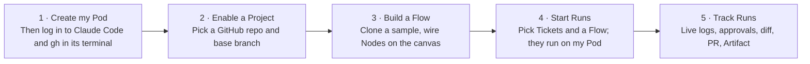
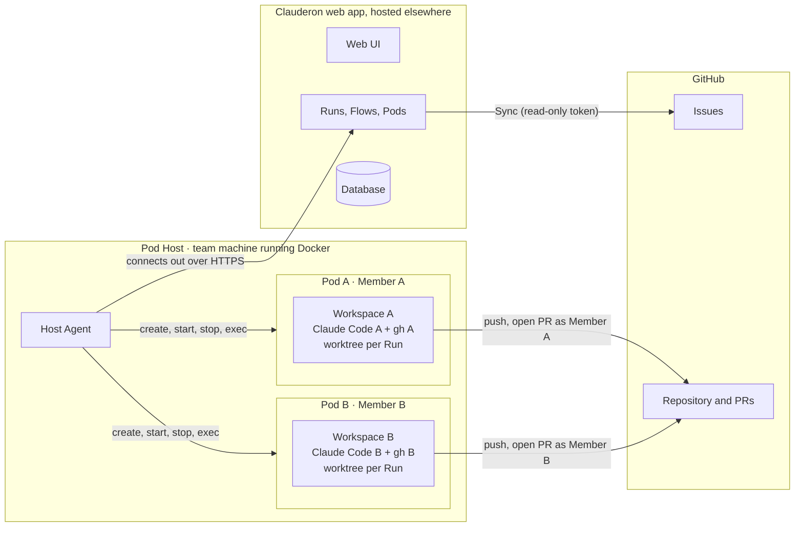
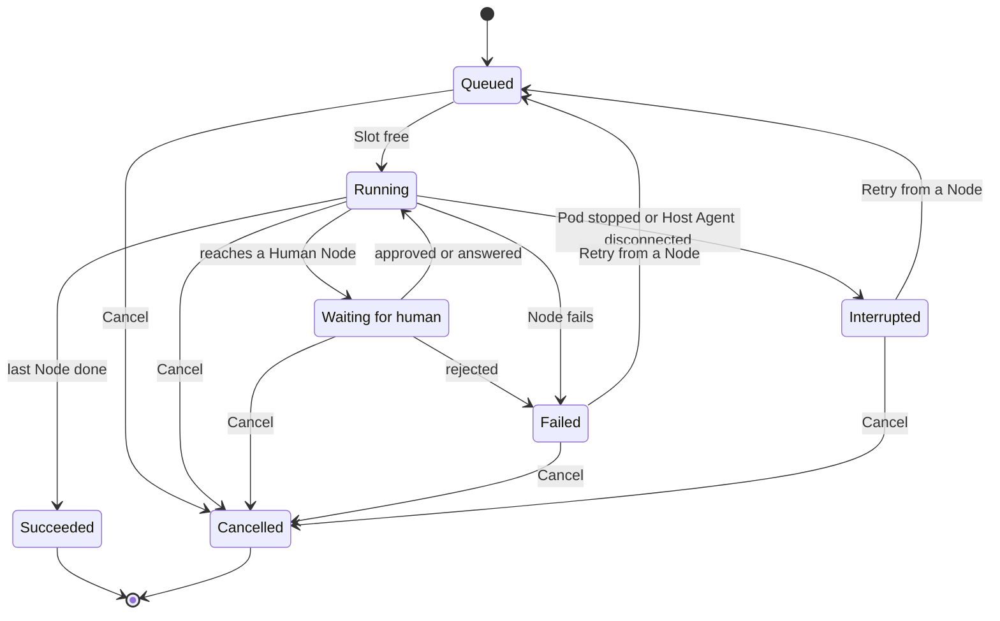

# Clauderon — Requirements v1 (final)

> **Version:** v1 final · **Date:** 2026-11-12, updated 2026-11-13 (Pods are per-Member Docker containers on one Pod Host; sign-in with Google) · **Status:** Requirements settled; no technical design or code yet.
> **Sources:** merges two earlier drafts, a team draft and a practice draft, following the practice draft's outline. Neither is kept in the repo any more; git history has them. Every point where they differed was settled on 2026-11-12; see [section 9](#9-decision-log-2026-11-12).
> **Next step:** design, then spec, then implementation plan (section 12).

---

## 1. Overview

**Clauderon** is a shared web app with its own database that lets one team run GitHub issues through Flows on personal Pods: Docker containers, one per Member, on a single team machine (the Pod Host). Claude Code, shell commands and people work through each Ticket and leave a branch, a pull request, logs and an Artifact behind. It has four modules:

- **Pods**: one Docker container per Member on the Pod Host, built from one standard Ubuntu image, holding that Member's Claude Code and gh logins in its own Workspace. A Host Agent on the Pod Host connects out to the app and runs Nodes in a git worktree per Run.
- **Flows**: directed acyclic graphs drawn on a canvas. Each Node uses a Task, an Agent, Command or Human step with typed inputs and Outputs.
- **Tickets**: open GitHub issues of a Project, pulled in with a **Sync** button.
- **Runs**: one Flow applied to one Ticket on one Pod. Runs can stop and wait for a person (Approve, Grill).

**How the team uses it:**

**Use case:** a team member creates their Pod and logs in to Claude Code and gh once, clones the sample Flow "ticket → plan → approve → code → test → PR", picks a few Tickets and starts them as a Batch on their Pod, answers Claude's questions and approves the plan, then reads each Run's Artifact and reviews the pull request on GitHub.

**How the pieces connect:**

The app never connects into the Pod Host and never writes to GitHub. Everything that writes to GitHub happens inside the Starter's Pod, under the Starter's own gh login.

---

## 2. Goals and success measures

### Goals

1. **Hands-off:** turn a GitHub issue into a reviewable pull request without a person driving the agent.
2. **Repeatable:** every Ticket of a kind goes through the same Flow.
3. **Visible:** anyone can see who started a Run, what each Node did, what it cost in tokens and time, and what it produced.

### Success measures

Product measures (targets to set after M2):

| # | Measure |
| --- | --- |
| S1 | Share of Runs that end in a merged pull request |
| S2 | Median time from Start to pull request opened |
| S3 | Tickets run per week |

Acceptance checks:

| # | Check | How to verify |
| --- | --- | --- |
| A1 | One real Ticket runs through the sample Flow and its Run shows a link to a real pull request | Live demo |
| A2 | 10 Tickets started as a Dry-run Batch on a Pod with 2 Slots never run more than 2 at once; the rest stay Queued and start first-in, first-out | Automated test plus demo |
| A6 | Two Members each create a Pod on the Pod Host, log in to their own Claude Code and gh, and each opens a pull request under their own GitHub name | Live demo |
| A3 | The Flow editor rejects an edge whose Output Type does not match the input, and rejects any cycle | Unit tests of the validator |
| A4 | Each Run shows the correct state of every Node: queued, running, waiting for human, succeeded, failed | Manual script plus runner unit tests |
| A5 | Reloading the page or restarting the app loses no Pods, Flows, Runs or logs | Manual check |
| A7 | An allowlisted Google account signs in and its email shows on its actions; a Google account not on the allowlist is refused; removing an email ends that Member's session | Manual check |

---

## 3. Scope

### In scope

- **People:** one team on one shared web app with its own database. A member signs in with their Google account; only email addresses on the app's allowlist get in.
- **Projects:** each Project is one GitHub repository and its base branch. Several Projects can be enabled.
- **Pod Host:** exactly one team machine running Docker (for example Docker Desktop on an ARM64 Mac), always on, with one Host Agent that connects out to the app.
- **Pods:** one Docker container per Member on the Pod Host, created, started, stopped, recreated and deleted from the app; one standard Ubuntu image; a Workspace volume per Pod; Slots and CPU/RAM limits; a web terminal for the owner to log in to Claude Code and gh; measured CPU, RAM and disk use.
- **Tickets:** open GitHub issues pulled in with a manual **Sync**, with a list, search, filter, a detail view and multi-select to start Runs.
- **Flows:** a canvas editor for directed acyclic graphs. Edges are type-checked by Output Type and cycles are rejected. Sample Tasks and Flows are seeded, and members clone them to edit.
- **Runs:** Batches, a queue per Pod, Human Nodes (Approve, Grill), Retry from any Node, Cancel, Dry-run, live logs, usage per Node and an Artifact per Run.
- **Real runner:** Claude Code and shell commands in the Starter's Pod, one git worktree per Run in its Workspace, a real branch and pull request pushed with the Starter's own gh login.

### Out of scope

- Sign-in methods other than Google (password, GitHub OAuth, other SSO), managing the allowlist from the app, roles and permissions, multiple teams, billing.
- Ticket sources other than GitHub Issues, and code hosts other than GitHub.
- Agents other than Claude Code.
- More than one Pod Host; Pods on machines other than the Pod Host; VMs.
- Pods shared by several Members, or running a Run on someone else's Pod; moving a Run to another Pod.
- Forwarded ports from Pods, Tailscale, opening the Pod Host to inbound connections.
- An image per Project; automatic recreation of Pods when the image changes.
- Automatic Retry after a Pod or the Host Agent comes back.
- Automatic issue sync (polling, webhooks) and starting Runs automatically when a Ticket appears.
- Writing to GitHub from the app: changing issue state or labels, commenting on issues.
- Cycles in a Flow, Loop-backs, Skip Conditions, parallel execution of Nodes within a Run.
- Flow versioning.
- Default Flow per Project, and Built-in versus Project Task sources.
- Pod Environment managed by the app (variables and secrets live in the Pod's Workspace).
- A Run that changes several repositories.

---

## 4. Functional requirements

Priority: **Must** / **Should** / **Could**.

### 4.1 Members and Projects

| ID | Requirement | Priority |
| --- | --- | --- |
| MEM-1 | Sign in with Google. Only verified Google email addresses on the allowlist can sign in; any other address sees an "access denied" page. A Member is identified by that email, shown by the Google name and picture, and named on every action they take. Sign out ends the session. | Must |
| MEM-3 | The allowlist of email addresses lives in the app's configuration, set by whoever runs the app. The first sign-in of an allowed email creates the Member. Removing an email blocks new sign-ins and ends its open sessions; the Member's Pod, Runs and audit entries are kept. | Must |
| MEM-2 | Every member can approve, reject, answer, cancel and retry any Run. Starting a Run and opening a Pod's terminal are tied to the Member's own Pod (POD-3, POD-9). | Must |
| PRJ-1 | Enable a GitHub repository as a Project, with its base branch. | Must |
| PRJ-2 | Store one read-only GitHub token for the app (Issues and Pull requests read), encrypted at rest. | Must |

### 4.2 Pods

| ID | Requirement | Priority |
| --- | --- | --- |
| POD-1 | One Pod Host: the Host Agent on it connects out to the app over HTTPS and carries out every Pod and Run command; the Pod Host needs no inbound port ([ADR 0003](../adr/0003-pods-are-member-containers-on-one-pod-host.md)). | Must |
| POD-2 | **Create my Pod**: a Member without a Pod creates one Docker container from the standard Ubuntu image, with a Workspace volume, Slots (default 2) and CPU/RAM limits. A Member has at most one Pod. | Must |
| POD-3 | Every Run runs on its Starter's Pod. Running Runs never exceed the Pod's Slots; extra Runs wait in that Pod's queue and start first-in, first-out. | Must |
| POD-4 | Pods page: a Pod Host card (Host Agent connected or not, Docker running, architecture, total CPU, RAM and disk) containing every Pod with its owner, status, image, Claude Code and gh login state, Slots in use and queue. | Must |
| POD-5 | **Pod Ready** means the container is running and Claude Code and gh are logged in. Start is refused while the Starter has no Pod or its Claude Code or gh login is missing, with a link to the terminal. A stopped Pod with both logins accepts Runs; they wait in its queue until it starts. | Must |
| POD-6 | The owner can Start, Stop and **Recreate** their Pod. Recreate replaces the container with the current image and keeps the Workspace; the Pod shows when a newer image is available. Stop and Recreate are refused while the Pod has Running or Waiting Runs. | Must |
| POD-7 | **Delete Pod** removes the container and its Workspace, logins included; refused while the Pod has Active Runs. | Should |
| POD-8 | Show measured CPU, RAM and disk use per Pod. | Could |
| POD-9 | Web terminal into the Pod, for its owner only (the signed-in Member whose Pod it is), to log in to Claude Code and gh and to inspect the Workspace. Every terminal session is recorded in the audit log. | Must |
| POD-10 | The Workspace keeps the Member's Claude Code and gh logins, one clone per Project and one git worktree per Run; it survives Stop and Recreate. | Must |
| POD-11 | Pushes and pull requests use the Starter's own gh login in their Pod, so pull requests carry the Starter's GitHub name ([ADR 0001](../adr/0001-pods-push-with-their-own-git-login.md)). | Must |

### 4.3 Tickets

| ID | Requirement | Priority |
| --- | --- | --- |
| TIC-1 | Ticket list per Project: key (`ledger-api#412`), title, labels, Ticket status. | Must |
| TIC-2 | Search by title or key; filter by Project and Ticket status. | Should |
| TIC-3 | Select several Tickets → **Start** (see RUN-1). | Must |
| TIC-4 | Ticket detail: issue body from GitHub, every Run of the Ticket, links to their pull requests and Artifacts. | Should |
| TIC-5 | **Sync** button pulls the open issues of a Project from GitHub. Sync never starts a Run. | Must |
| TIC-6 | Ticket status is derived, never stored: `Open` (no Active Run), `Queued`, `In run`, `Needs you` (waiting for human), `Failed`, `Interrupted`, `PR open`, `PR merged`, `Closed` (issue closed on GitHub). | Must |
| TIC-7 | A Ticket has at most one Active Run. Dry-run Runs do not count. | Must |
| TIC-8 | The app never changes issue state or labels and never comments on issues; pull requests reference the issue with `Refs #<n>`. | Must |

### 4.4 Flows

| ID | Requirement | Priority |
| --- | --- | --- |
| FLW-1 | Task library: each Task has a name, a kind (Agent, Command, Human), instructions or a command, typed inputs and typed Outputs. | Must |
| FLW-2 | Human Tasks come in two kinds: **Approve** (Approve / Reject with feedback) and **Grill** (Claude asks, a member answers, Claude continues in the same session until it produces its Output). | Must |
| FLW-3 | Canvas editor: drag Tasks in as Nodes, connect an Output to an input. | Must |
| FLW-4 | An edge is allowed only when the Output Type matches the input; a mismatch shows an error on the edge. | Must |
| FLW-5 | Validate before saving: exactly one entry Node (takes the `issue`), at least one end Node, no cycles, no required input left unconnected. A Flow with problems shows an "N problems" badge and cannot start Runs. | Must |
| FLW-6 | Node panel: name, extra instructions for this Node, optional Outputs on or off. | Must |
| FLW-7 | A Flow cannot be edited while any Active Run (Dry-run included) uses it. There are no Flow versions. | Must |
| FLW-8 | Seed sample Tasks (`Grill a plan`, `Approve a plan`, `Code a change`, `Run tests`, `Open a pull request`) and sample Flows (`Basic ticket delivery`, `Plan and deliver`). Samples are read-only; members **clone** them to edit. | Must |

Output Types for v1: `issue`, `plan`, `branch`, `test-result`, `pull-request`, `summary`, `screenshot`.

### 4.5 Runs

| ID | Requirement | Priority |
| --- | --- | --- |
| RUN-1 | Start dialog: pick a Flow, the Tickets, optional extra instructions, and mode `Real` / `Dry-run`. The Batch always runs on the Starter's Pod, shown with its Slots and queue. One Run per Ticket; Runs started together form a Batch. | Must |
| RUN-2 | A Run executes its Nodes **one at a time** in topological order, each Node once all its required inputs exist. | Must |
| RUN-3 | Each Run has its own git worktree and branch in the Starter's Workspace; all Nodes of the Run share that worktree. | Must |
| RUN-4 | A Human Node puts the Run in `waiting for human`. The Run keeps its Slot and there is no timeout. | Must |
| RUN-5 | **Needs you** queue: every Node waiting for a person, across all Runs, in one place. | Must |
| RUN-6 | Reject (Approve kind) fails the Node and the Run becomes `Failed`, keeping the feedback. | Must |
| RUN-7 | **Retry** from any Node of a `Failed` or `Interrupted` Run: that Node and everything after it run again as new Attempts; the latest Reject feedback is passed to the retried Node. Earlier Attempts' Outputs and logs stay visible. | Must |
| RUN-8 | **Cancel** ends any Active Run (Queued, Running, Waiting for human, Failed, Interrupted) as `Cancelled`. | Must |
| RUN-9 | A `Failed` or `Interrupted` Run stays Active until it is retried to success or cancelled: it keeps the Ticket's single Active Run and the Flow's edit lock, but not a Slot. | Must |
| RUN-10 | Real runner: Agent Nodes run Claude Code headless in the Starter's Pod with the Starter's own subscription; Command Nodes run a shell command there; output streams to the browser through the Host Agent. | Must |
| RUN-11 | The `Open a pull request` Task pushes the branch and opens the pull request with the Starter's gh login, only when there are changes. The body includes `Refs #<n>`. | Must |
| RUN-12 | When a Pod stops or crashes, or the Host Agent loses its connection, the Pod's running Runs become `Interrupted`; queued Runs wait for the Pod to run again. Nothing is retried automatically: the Starter checks and retries. After an app restart, Runs left running are marked `Interrupted`. | Must |
| RUN-13 | Dry-run: a simulated runner (each Node 2–8 s, configurable failure rate, fake Outputs such as `branch: feat/412-retry`, `pr: #88`). It occupies a Slot and locks the Flow but does not count toward the Ticket's Active Run and never touches GitHub or Claude. Dry-run Runs are clearly marked. | Must |
| RUN-14 | The worktree is deleted when a Run ends as `Succeeded` or `Cancelled`; it is kept while the Run is `Failed` or `Interrupted`. | Should |
| RUN-15 | Every action on a Run (start, approve, reject, answer, cancel, retry) and every Pod action (create, start, stop, recreate, delete, terminal session) records the Member's email and time. | Should |

**Run lifecycle:**

A Run holds a Slot only while Running or Waiting for human.

### 4.6 Tracking

| ID | Requirement | Priority |
| --- | --- | --- |
| TRK-1 | Run page: timeline of Nodes with state, duration and live log; logs kept after the Run ends. | Must |
| TRK-2 | Each Node's Outputs, per Attempt. | Must |
| TRK-3 | Diff of the Run's branch and the pull request link. | Must |
| TRK-4 | Usage: tokens and duration per Node, and totals per Run, taken from what Claude Code reports. | Should |
| TRK-5 | **Artifact:** when a Run ends, it gets one Artifact summarising its work: what changed, how to test it, screenshots, the pull request link. Shown on the Run page and written into the pull request body. | Should |
| TRK-6 | Batch page: each Run of a Batch with its state, current Node and pull request. | Should |
| TRK-7 | Runs list: Ticket, Flow, mode, state, Starter, times; filter by state, Flow and Pod. | Must |

### 4.7 Non-functional requirements

| ID | Area | Requirement | Priority |
| --- | --- | --- | --- |
| NFR-1 | Security | The app's GitHub token and Google OAuth client secret are encrypted at rest or kept out of the database; tokens and secrets are masked in every log the app stores or shows; sign-in sessions use secure, HTTP-only cookies and expire. | Must |
| NFR-2 | Audit | See RUN-15. | Should |
| NFR-3 | Resilience | The Host Agent reconnects by itself after a network drop or a Pod Host restart. | Must |
| NFR-6 | Isolation | Each Pod has its own container, Workspace volume and CPU/RAM limits, so one Member's Runs cannot read another Member's Workspace or starve the Pod Host. | Must |
| NFR-4 | Latency | Node output reaches the browser within a few seconds. | Should |
| NFR-5 | Durability | Flows, Runs and logs survive app restarts and are backed up; log retention to set. | Should |

### 4.8 Screens

| Screen | Shows | Main actions |
| --- | --- | --- |
| Sign in | Sign in with Google button; access denied page for emails not on the allowlist | Sign in, sign out |
| Projects | Enabled repositories | Enable a repo, set base branch, Sync |
| Tickets | Tickets per Project with derived status | Search, filter, select, Start |
| Start dialog | Flow, mode, extra instructions, selected Tickets, the Starter's Pod with its Slots | Start the Batch |
| Flows | Flow list, Task library, canvas editor with problems badge | Clone a sample, add Nodes, connect Outputs, save |
| Pods | Pod Host card with every Pod; Pod detail: owner, status, image, Claude Code and gh login state, Slots, queue, health | Create my Pod, start, stop, recreate, delete, set Slots |
| Pod terminal | A shell in the owner's Pod | Log in to Claude Code and gh, inspect the Workspace |
| Runs | Runs list with filters | Open a Run |
| Run | Node timeline, live logs, Outputs per Attempt, diff, PR, usage, Artifact | Approve, reject, answer, retry from a Node, cancel |
| Batch | Runs of one Batch | Open a Run |
| Needs you | Every Node waiting for a person | Approve, reject, answer |

---

## 5. Constraints and assumptions

### Constraints

- No fixed deadline; work is delivered milestone by milestone (section 7).
- Exactly one Pod Host. Its CPU, RAM and disk cap how many Pods and concurrent Runs the team can have.
- Claude Code in each Pod runs under its owner's own subscription, so each Member's Runs are limited by that Member's quota.
- Company repositories may be used; see risk R1.

### Assumptions

- The Pod Host is a team machine that stays on, runs Docker (for example Docker Desktop on an ARM64 Mac), and reaches the app and GitHub over outbound HTTPS.
- The Clauderon web app and its database are hosted somewhere every Member can reach; where is an open question.
- The standard image is Ubuntu-based with git, gh, Node and the Claude Code CLI, built for the Pod Host's architecture.
- Claude Code runs headless in a container, can resume a session (for Grill), and reports output and token usage as it goes.
- Every Member has a Google account (Google Workspace or personal Gmail) with the email on the allowlist. The app is registered as a Google OAuth client, and its URL is the redirect target.
- Tech stack is undecided (the practice draft suggested React, TypeScript, Vite, React Flow, Zustand and Vitest for the UI).

---

## 6. Risks

| # | Risk | Level | Mitigation |
| --- | --- | --- | --- |
| R1 | **Company policy:** company repositories, personal Claude subscriptions on Pods and a bot-like account opening pull requests | High | Ask IT and leads before M1. Fallback: a sandbox repository |
| R2 | **Broad personal credentials:** an issue's text reaches the agent's prompt, and a Member's gh login can usually reach every repository they can, so a malicious issue could steer the agent beyond the Project | High | Log in gh with a fine-grained token limited to the Projects' repositories; show the gh account and its scope on the Pod page |
| R7 | **Stolen Google session:** whoever holds a Member's signed-in session or Google account can start Runs on that Member's Pod, spending their Claude quota and opening pull requests under their GitHub name | Medium | Google sign-in with verified email and allowlist; sessions expire; removing an email ends its sessions; every action is audited |
| R8 | **One Pod Host is a single point of failure:** if it is off, offline or out of disk, no Member can run anything | Medium | Keep it on a UPS and wired network; Interrupted Runs are retried by hand; show Pod Host health on the Pods page |
| R9 | **Docker Desktop licence:** companies above 250 employees or USD 10 million revenue need a paid subscription | Low | Check with IT; an alternative Docker engine works the same for Clauderon |
| R3 | **Anthropic terms** for running Claude Code headless on a subscription from a separate app | Medium | Check the official terms during design. Fallback: an API key on the Pod |
| R4 | Subscription quota runs out mid-Run | Medium | The Node fails with a clear reason and can be retried; load-test with Dry-run |
| R5 | A Node waiting for a person holds a Slot indefinitely | Medium | Needs you queue; any member can answer or cancel |
| R6 | **Allowlist drift:** someone who leaves the team keeps access until their email is removed from the configuration | Low | Remove the email when a Member leaves; their Runs and audit entries stay |

---

## 7. Roadmap

Proposed split for the team to confirm. No dates: each milestone ends when its check passes.

| Milestone | Delivers | Check |
| --- | --- | --- |
| **M0 — Model and seed** | Domain model, persistence, seeded Tasks and Flows, Google sign-in with the allowlist | Model unit tests pass; A5, A7 |
| **M1 — Walking skeleton** | Pod Host with its Host Agent, Create my Pod, terminal login, one Project, Sync, a fixed sample Flow with Agent and Command Nodes, live logs, real branch and pull request | A1 |
| **M2 — Flows and scheduling** | Canvas editor and validator, clone samples, Flow edit lock, a Pod per Member with Slots, limits and queue, Batches, Dry-run | A2, A3, A6 |
| **M3 — People in the loop** | Approve and Grill Nodes, Needs you, Retry from any Node, Cancel, Attempts, audit | A4 |
| **M4 — Refinement** | Usage, Artifact, diff, Batch page, Interrupted Runs, Pod Start/Stop/Recreate/Delete, Pod and Pod Host health, worktree cleanup | Demo of the full journey |

**If time is short, cut in this order:** POD-8 → TRK-4 → TRK-6 → POD-7 → the Grill kind in FLW-2.

---

## 8. Open questions

1. Where are the Clauderon web app and its database hosted (company server or cloud), and who can reach the URL?
2. How is the Host Agent installed and paired with the app (one-time token, install script), and how does it restart with the Pod Host?
3. Default CPU and RAM limits per Pod, and how many Pods the Pod Host can hold.
4. Who maintains the standard image, and which toolchains does it include besides Node?
5. How is the Artifact produced: assembled from Node Outputs, written by a final Agent Node, or both? How are screenshots captured?
6. Is the Output Type list in 4.4 complete for the sample Flows?
7. Can cost be shown in money when Claude Code runs on a subscription, or only as tokens?
8. Log retention and backup schedule.
9. Tech stack for the app.
10. Who owns the Google OAuth client (which Google Cloud project), and how long a sign-in session lasts before Google sign-in is asked again?

---

## 9. Decision log (2026-11-12)

How each difference between the two drafts was settled. "Team" is the team draft, "Practice" is the practice draft.

| Topic | Decision | Follows |
| --- | --- | --- |
| Purpose | A product the team uses, not a practice exercise | Team |
| People | One team; sign in by typing a username, no verification (superseded 2026-11-13: Google sign-in, see below) | New |
| Who can approve or cancel | Any member; actions are recorded with who did them | New |
| Timeline | No fixed deadline; milestones | Team |
| GitHub writes | The Pod pushes and opens pull requests with its own git/gh login | New ([ADR 0001](../adr/0001-pods-push-with-their-own-git-login.md)) |
| GitHub reads | The app holds one read-only token for issues and pull requests | New |
| Issue comments | None; the app never writes to GitHub | Practice |
| Ticket sync | Manual Sync button only | Practice |
| Ticket status | Derived from Runs, the pull request and the issue | New |
| One Active Run per Ticket | Yes; Dry-run excluded | Team |
| Pods | Several Pods, each with a Pod Daemon that connects out (superseded 2026-11-13, see below) | Team |
| Pod Environment | Dropped; the Pod's own environment is used | New |
| Pod health and ports | Measured CPU, RAM, disk; forwarded-port metadata (ports dropped 2026-11-13) | Practice |
| Heartbeat and Interrupted | Kept | Team |
| Flow shape | Typed DAG on a canvas, no cycles | Practice ([ADR 0002](../adr/0002-flows-are-typed-dags-run-sequentially.md)) |
| Node execution | One Node at a time, in topological order | New |
| Node kinds | Tasks of kind Agent, Command or Human; Human is Approve or Grill | Merged |
| Grill | Resume the same Claude session | New |
| Reject | Fails the Node; the member retries by hand | Practice |
| Retry | From any Node, with the Reject feedback | New |
| Failed Run | Stays Active until retried or cancelled | New |
| Cancel | One action ends any Active Run | New |
| Approval timeout | None; the Run keeps its Slot | Team |
| Flow versions | None; a Flow is locked while an Active Run uses it | New |
| Task and Flow library | Seeded samples, cloned to edit; no Default Flow, no Skip Conditions | Practice, trimmed |
| Dry-run | Option at Start; occupies a Slot, does not block the Ticket | Practice |
| Worktree cleanup | When a Run ends as Succeeded or Cancelled | New |
| Batch | Kept, with a Batch page | Team |
| Artifact | One summary per Run: changes, how to test, screenshots, PR link | New |
| Terms | Node (not Step), Attempt, Output and Output Type | Practice |
| NFRs | Token security, audit, reconnect, latency; durability as Should | Team, trimmed |

Updates on 2026-11-13, moving Pods to Docker on one machine:

| Topic | Decision | Supersedes |
| --- | --- | --- |
| Pod | One Docker container per Member, on one Pod Host | Team machines, each a Pod |
| Pod Host | One always-on team machine running Docker | Several machines |
| Control path | A Host Agent on the Pod Host connects out to the app ([ADR 0003](../adr/0003-pods-are-member-containers-on-one-pod-host.md)) | Pod Daemon per Pod |
| Web app | Shared web app with its own database, hosted elsewhere; hosting is an open question | Self-hosted on the same machine |
| Pod lifecycle | The owner creates, starts, stops, recreates and deletes their Pod from the app | App never provisions Pods |
| Workspace | A volume per Pod keeps logins, clones and worktrees; survives Stop and Recreate; deleted with the Pod | — |
| Image | One standard Ubuntu image; the owner recreates to adopt a new one | — |
| Limits | Slots plus CPU/RAM limits per container | Slots only |
| Logins | Each Member logs in to their own Claude Code and gh through a web terminal; terminal for the owner only | Pod's own gh account |
| Run placement | Always on the Starter's Pod; no Pod picker, no moving Runs | Starter picks a Pod |
| Start rule | Only when the Starter's Pod has both logins; a stopped Pod queues | — |
| Pod down | Running → Interrupted; queued waits; no automatic Retry | Heartbeat lost → Interrupted, move queued Runs |
| Sign-in | Google sign-in; only emails on an allowlist in the app's configuration; a Member is identified by email; typed usernames removed; R7 lowered to Medium | Typed username |
| Ports | Forwarded ports dropped from v1 | Port metadata |

---

## 10. Glossary

The full glossary is [CONTEXT.md](../../CONTEXT.md). Key terms:

| Term | Meaning |
| --- | --- |
| Project | One GitHub repository enabled in the app, with its base branch |
| Ticket | An open GitHub issue in a Project, pulled in by Sync |
| Pod Host | The one team machine running Docker where every Pod lives |
| Host Agent | The process on the Pod Host that connects out to the app and manages Pods and Runs |
| Pod | One Member's Docker container on the Pod Host, where that Member's Runs execute |
| Workspace | A Pod's persistent storage: logins, Project clones, Run worktrees |
| Pod Ready | A Pod that is running with Claude Code and gh logged in |
| Slot | One unit of a Pod's capacity; one running Run each |
| Task | A reusable step definition: kind, instructions, typed inputs and Outputs |
| Flow | A directed acyclic graph of Nodes that a Ticket goes through |
| Node | One use of a Task inside a Flow |
| Output / Output Type | A typed value a Node produces and later Nodes consume |
| Run | One Flow applied to one Ticket on one Pod |
| Attempt | One execution of a Node in a Run; Retry creates a new one |
| Artifact | The summary of a Run's work, produced when it ends |
| Batch | The Runs started together in one action |
| Dry-run | A Run using the simulated runner |

---

## 11. Related documents

- [CONTEXT.md](../../CONTEXT.md): domain glossary
- [docs/adr/](../adr/): architecture decision records

## 12. Next steps

1. Answer open questions 1, 2 and 3, and settle risks R1 and R9 with IT and leads.
2. Design part by part: data model → run engine and scheduler → Human Nodes (Approve, Grill) → Host Agent protocol and Pod lifecycle → GitHub integration → error handling → testing.
3. Choose the tech stack.
4. Write the spec, review it, then the implementation plan.
