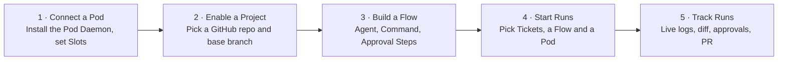
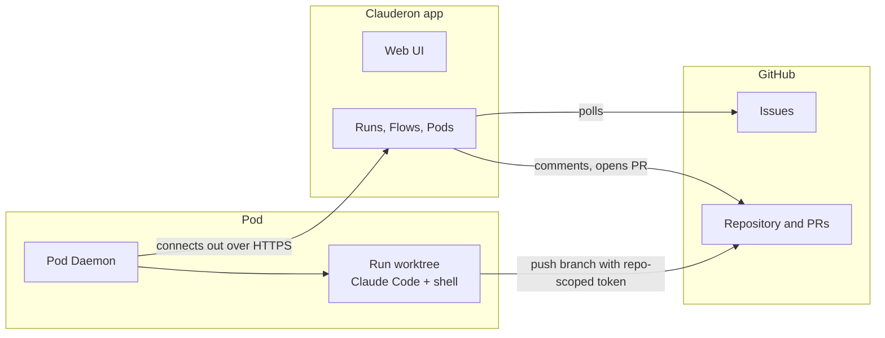
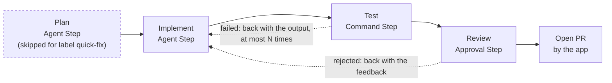
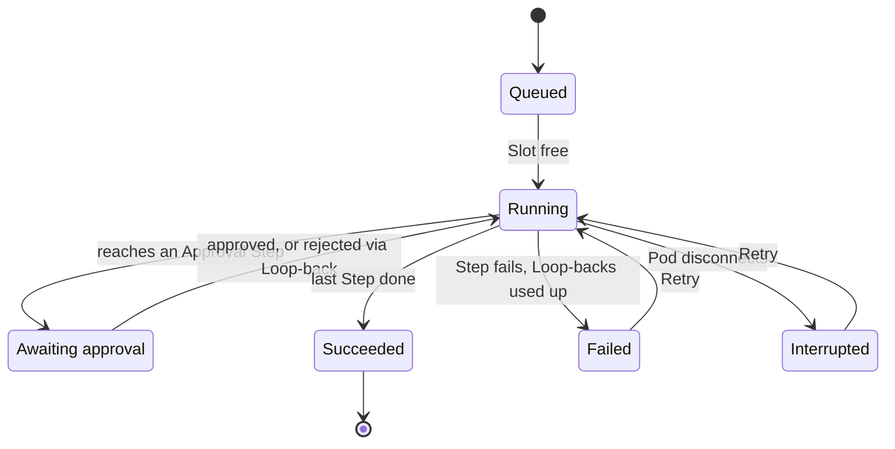
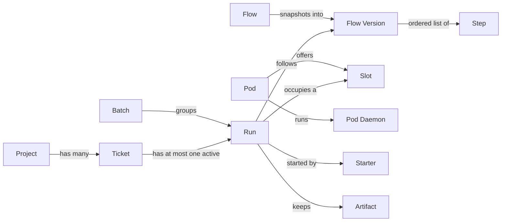

# Clauderon — v1 Requirements

> Snapshot of the shared [Claude Doc](https://claude.ai/artifact/VmpCAZcggaxRg6SoAUKJne) on 2026-11-12. The Claude Doc is the source of truth; update both when requirements change.

Clauderon is a self-hosted web app that lets one team run GitHub issues through configurable Flows on the team's own machines (Pods), where AI coding agents, shell commands and human approvals turn each issue into a branch, a pull request and a full log.

## At a glance

| Question | v1 answer |
| --- | --- |
| Who uses it | One team, on one self-hosted instance |
| Where work comes from | GitHub Issues, synced every few minutes |
| Where work runs | The team's own machines (Pods), via Claude Code and shell |
| What a Run is | One Ticket × one Flow on one Pod, acting as its Starter |
| What a Run produces | A branch, a pull request, logs and Artifacts |

Glossary, trade-offs and assumptions are in [Reference](#reference).

## Goals

Draft for the team to confirm: today, running an AI agent on an issue is manual, one at a time, and leaves no shared record.

- **Hands-off:** turn a GitHub issue into a reviewable pull request without a person driving the agent.
- **Repeatable:** every Ticket of a kind goes through the same Flow.
- **Visible:** anyone can see who started a Run, what each Step did and what it produced.

Success measures, targets to set: share of Runs ending in a merged pull request; median time from Start to pull request; Tickets run per week.

## Users and roles

v1 enforces no roles: any member can wear any of these hats.

| Hat | Does in the app |
| --- | --- |
| Pod maintainer | Installs the Pod Daemon, sets Slots and Pod Environment, watches Pod health |
| Flow author | Builds and versions Flows: Steps, prompts, Loop-backs, timeouts |
| Starter | Starts Runs, approves or rejects, cancels, retries |
| Reviewer | Reviews and merges the pull request on GitHub, outside the app |

## How the team uses it

A team member goes from an idle machine to tracked pull requests in five steps.

## Scope

v1 serves one team on one self-hosted instance, with GitHub as both tracker and code host.

| In v1 | Out of v1 |
| --- | --- |
| One team, self-hosted, no tenancy or billing | Multiple teams or SaaS |
| GitHub Issues as the only Ticket source | Jira, Linear, GitHub Projects boards |
| GitHub as the only code host | GitLab, Bitbucket |
| Claude Code as the agent, behind an adapter | Other agents (Codex, Gemini CLI) |
| Pods the team already owns | Pods the app provisions (containers, VMs) |
| Linear Flows with Loop-backs and Skip Conditions | Parallel Steps, full DAGs, canvas editor |
| One repository per Run | Tickets that change several repositories |

## How it fits together

The app never connects into a Pod. Agent and Command Steps run inside the Run's worktree on the Pod.

## Example Flow

Plan has a dashed border because its Skip Condition skips it for Tickets labelled quick-fix. Step names are an example; teams build their own.

## Pods

A Pod is a machine the team already owns; the app never provisions one.

| ID | Requirement | Priority |
| --- | --- | --- |
| POD-1 | Pod Daemon connects out; no inbound port or SSH | Must |
| POD-2 | Register a Pod with a name and Slots | Must |
| POD-3 | Runs at once ≤ Slots; extra Runs queue on that Pod | Must |
| POD-4 | Pod Environment: variables and secrets for every Run | Must |
| POD-5 | Show status, Slots in use and Runs per Pod | Must |
| POD-6 | Show CPU, memory and disk usage | Could |
| POD-7 | Delete finished Run directories after N days | Should |

Each Run works in its own git worktree. Claude Code must already be signed in on the Pod (see [Assumptions](#assumptions-and-dependencies)).

## Projects and Tickets

A Project is one GitHub repository; its open issues are the Tickets, and GitHub stays the source of truth.

| ID | Requirement | Priority |
| --- | --- | --- |
| PRJ-1 | Enable a GitHub repo as a Project, with its base branch | Must |
| PRJ-2 | Sign in with GitHub; members come from the configured org or team | Must |
| TKT-1 | Poll open issues every few minutes; Refresh on demand | Must |
| TKT-2 | Show each Ticket's Active Run | Must |
| TKT-3 | Comment on the issue when a Run ends: status, Run link, PR link | Should |
| TKT-4 | Never change issue state or labels; PRs say `Refs #<n>` | Must |

## Flows

A Flow is an ordered list of Steps with simple branching; any team member can create or edit one.

| ID | Requirement | Priority |
| --- | --- | --- |
| FLW-1 | Three Step types: Agent, Command, Approval | Must |
| FLW-2 | Prompt variables: Ticket, earlier Step output, feedback | Must |
| FLW-3 | All Steps of a Run share one working directory | Must |
| FLW-4 | Loop-back on rejection, carrying the feedback | Should |
| FLW-5 | Loop-back on failure, carrying the output, at most N times | Should |
| FLW-6 | Skip Condition on Ticket fields, such as a label | Could |
| FLW-7 | Timeout per Step; a timeout counts as a failure | Must |
| FLW-8 | Each save creates a Flow Version; Runs keep theirs | Must |

Variables: `{{ticket.title}}`, `{{ticket.body}}`, `{{steps.<name>.output}}`, `{{feedback}}`.

## Runs

A Run is one Flow Version applied to exactly one Ticket on one Pod, acting as the person who started it.

| ID | Requirement | Priority |
| --- | --- | --- |
| RUN-1 | One Run per selected Ticket, grouped as a Batch | Must |
| RUN-2 | The Starter picks one Pod for the whole Batch | Must |
| RUN-3 | At most one Active Run per Ticket | Must |
| RUN-4 | Own branch per Run; PR opened when there are changes | Must |
| RUN-5 | Acts as the Starter with a repo-scoped token that expires at the end | Must |
| RUN-6 | Only the Starter approves, rejects or cancels | Must |
| RUN-7 | Waiting for approval keeps the Slot; no approval timeout | Must |
| RUN-8 | Pod drops: running Runs become Interrupted, queued ones can move Pod | Should |
| RUN-9 | Retry from the Step where the Run stopped | Must |

## Tracking

Every Run keeps everything needed to judge its work after the fact.

| ID | Requirement | Priority |
| --- | --- | --- |
| TRK-1 | Live output per Step, kept after the Run ends | Must |
| TRK-2 | Diff and PR link on the Run page | Must |
| TRK-3 | Duration per Step, tokens per Agent Step | Should |
| TRK-4 | Artifacts: files a Step declares, downloadable | Could |
| TRK-5 | Batch view: state, current Step and PR per Run | Should |

## Non-functional requirements

Proposed for the team to confirm; numeric targets are open questions.

| ID | Area | Requirement | Priority |
| --- | --- | --- | --- |
| NFR-1 | Security | Secrets are encrypted at rest and masked in every log | Must |
| NFR-2 | Security | GitHub tokens never outlive their Run, on the app or the Pod | Must |
| NFR-3 | Audit | Record who started, approved, rejected, cancelled or retried each Run, and when | Should |
| NFR-4 | Latency | Step output reaches the browser within a few seconds | Should |
| NFR-5 | Resilience | The Pod Daemon reconnects by itself after a network drop | Must |
| NFR-6 | Scale | Sized for one team; target Pods and concurrent Runs to set | Should |
| NFR-7 | Backup | Flows, Runs and logs are backed up; log retention to set | Should |

## Run lifecycle

A Run keeps its Slot while Running or Awaiting approval. The Starter can cancel any Active Run, which then ends as Cancelled.

## Screens

Eight screens cover the five steps of the journey.

| Screen | Shows | Main actions |
| --- | --- | --- |
| Tickets | Open issues per Project, each with its Active Run | Select Tickets, Start |
| Start dialog | Flow and Pod pickers, Tickets selected | Start the Batch |
| Run | Steps with live output, diff, PR link, tokens, Artifacts | Approve, reject, cancel, Retry |
| Batch | Runs of one Batch with state and current Step | Open a Run |
| My approvals | Runs waiting for me at an Approval Step | Approve or reject |
| Flows | Flow list and editor, version history | Add Steps, Loop-backs, Skip Conditions, timeouts |
| Pods | Pod list and detail: status, Slots, queue, health | Register, set Slots and Pod Environment, move queued Runs |
| Projects | Enabled repositories | Enable a repo, set base branch |

## Milestones

| Milestone | Delivers |
| --- | --- |
| M1 · Walking skeleton | Pod Daemon, one Project; Agent and Command Steps; live output, branch and PR |
| M2 · Team use | Batches, Slots and the queue; Approval Steps and Retry; Flow Versions and timeouts |
| M3 · Refinement | Loop-backs, Skip Conditions; Artifacts, tokens, issue comments; Pod health, move queued Runs |

Proposed split for the team to confirm: Must items land in M1 and M2, Should and Could items in M3.

## Open questions

- [ ] Default Step timeout, and the default N for Loop-backs?
- [ ] How many days to keep a finished Run's working directory by default?
- [ ] Ticket poll interval?
- [ ] How is the Pod Daemon installed and paired with the app (one-time token, install script)?
- [ ] Can cost be shown in money when Claude Code runs on a subscription, or only as tokens?
- [ ] Tech stack and hosting for the app itself.

## Reference

Terms, deliberate trade-offs and assumptions behind the v1 requirements. The full glossary is in [CONTEXT.md](../../CONTEXT.md).

### Glossary

Use these words in code, UI and conversation; the right column lists words to avoid.

| Term | Meaning | Avoid |
| --- | --- | --- |
| Ticket | A GitHub issue in a Project's repository, synced into the app | Task, job |
| Project | One GitHub repository enabled in the app, with its base branch | Board, repo, workspace |
| Pod | A machine the team owns that the app runs Steps on | VM, server, runner, worker |
| Pod Daemon | The process on a Pod that connects out to the app and runs Steps | Agent, runner |
| Pod Environment | Variables and secrets given to every Run on a Pod | Config, vars |
| Slot | One unit of a Pod's capacity; one running Run each | Worker, concurrency |
| Flow | An ordered definition of Steps a Ticket goes through | Pipeline, workflow |
| Flow Version | An immutable snapshot of a Flow, taken on each save | Revision, draft |
| Step | One stage of a Flow: Agent, Command or Approval | Stage, job, node |
| Loop-back | A rule sending a Run back to an earlier Step with feedback or failure output | Retry, goto |
| Skip Condition | A rule skipping a Step for matching Tickets | Filter, guard |
| Run | One Flow Version applied to one Ticket on one Pod | Execution, build |
| Starter | The member who started a Run; the Run acts as them | Owner, requester |
| Active Run | A Run that has not finished; at most one per Ticket |  |
| Interrupted | A Run whose Pod disconnected mid-Step | Crashed, lost |
| Retry | The Starter re-running a Run from its stopped Step | Rerun, restart |
| Artifact | A file a Step keeps with the Run | Attachment |
| Batch | The Runs started together in one action | Bulk run |

### Accepted trade-offs and risks

These were chosen on purpose; revisit them before changing the related requirements.

| Decision | Why | Risk accepted |
| --- | --- | --- |
| Pods connect out through a Pod Daemon | No inbound ports, Pods behind NAT work, the app holds no SSH keys | One install step per Pod |
| Runs act as their Starter, token scoped to one repo | PRs carry the Starter's name; agents can call GitHub | A malicious issue could steer the agent within that one repository |
| Only the Starter approves and cancels | Clear ownership, no Admin role | An absent Starter leaves the Run waiting |
| Approval keeps the Slot, no timeout | Simpler scheduling | An unattended Approval blocks a Slot on that Pod indefinitely |
| Pod Environment is visible to agents | Steps need test credentials and keys | Secrets are exposed to the same prompt-injection risk as the token |
| Claude Code signed in on the Pod | No credential handling in the app | Cost may show only as tokens, not money, on a subscription |

### Assumptions and dependencies

- Pods run Linux or macOS, with git and the Claude Code CLI installed and signed in.
- Pods reach the app and GitHub over outbound HTTPS.
- The team installs a GitHub App on its organization; it issues repo-scoped user tokens.
- Claude Code runs headless and reports its output and token usage as it goes.
- The app needs no public URL: it polls GitHub instead of receiving webhooks.
