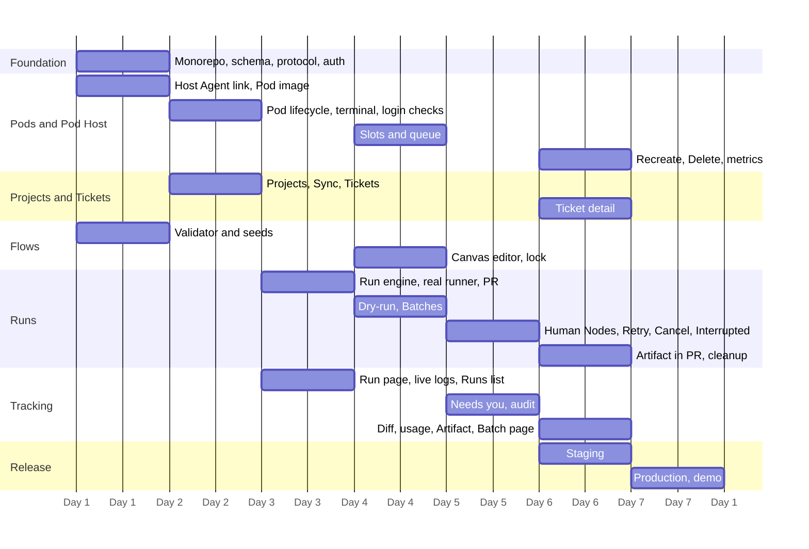

# Clauderon v1 — seven-day roadmap

> **Pods to Machines (2026-11-20):** written for Pods (one Docker container per Member on a Pod Host). Pods and the Host Agent are replaced by each Member's own Machine and the Agent ([ADR 0006](../adr/0006-each-member-runs-on-their-own-machine.md), [ADR 0007](../adr/0007-the-agent-ships-as-one-bundle-with-its-own-node.md)). Read Pod as Machine, Pod Host as the Member's computer, Host Agent as Agent. Where this disagrees with the ADRs or the code, they win. M4 is already updated.

> **Status:** proposal · **Date:** 2026-11-16 · **Scope:** everything in [v1 requirements](../requirements/v1-requirements.md), milestones M0–M4 in seven working days.
> **Assumption:** the team works with AI coding agents: people write the contracts, review every pull request and run the checks; agents write most of the code and tests.
> **Visual roadmap:** [Clauderon v1 Roadmap](https://claude.ai/artifact/T4AJv1hxGDNFb9Ktea7GV9) (hosted as a Claude artifact; source in [clauderon-v1-roadmap.html](clauderon-v1-roadmap.html)).
> **Specs:** one per milestone in [docs/specs](../specs/README.md).

---

## 1. At a glance

| Day | Milestone | Delivers | Check |
| --- | --- | --- | --- |
| 1 | **M0** Foundations | Monorepo, database schema, Host Agent protocol, domain core, seeds, Google sign-in with allowlist, Gateway ↔ Host Agent link, Pod image | Core unit tests; sign-in refuses unknown emails; Host Agent connected |
| 2 | **M1** Pods and Tickets | Pod lifecycle, web terminal, login checks, Workspace; Projects, Sync, Tickets, Pods page | **A7**; a Pod reaches Pod Ready; Sync pulls real issues |
| 3 | **M1** First pull request | Run engine, Agent and Command Nodes, Open a pull request, Start dialog, Run page with live logs, Runs list | **A1** |
| 4 | **M2** Flows and scheduling | Canvas editor and validator, clone samples, Flow lock, Slots and queue, Batches, Dry-run | **A2, A3, A6** |
| 5 | **M3** People in the loop | Approve and Grill Nodes, Needs you, Retry, Cancel, Attempts, Interrupted, audit | **A4, A5** |
| 6 | **M4** Refinement | Diff, usage, Artifact, Batch page, Pod Recreate and Delete, worktree cleanup, staging deploy | Full journey on staging |
| 7 | **Release** | Production deploy, backups, guides, bug bash, demo; buffer for anything that slipped | **A1–A7** on production |

---

## 2. Before Day 1

Nothing here is code, but every item can block a day.

| # | Item | Blocks |
| --- | --- | --- |
| P1 | Answers on R1 (company repos, personal Claude subscriptions), R3 (Anthropic terms), R9 (Docker Desktop licence). Fallback: a sandbox repository | Day 3 |
| P2 | Google OAuth client in the company's Google Cloud project, consent screen published | Day 1 |
| P3 | Fine-grained read-only GitHub token for the Projects' owner | Day 2 |
| P4 | The Pod Host machine on, Docker running, reachable outbound | Day 1 |
| P5 | Vercel project, Railway or Fly service, managed Postgres, GitHub Actions with GHCR | Day 1 |
| P6 | A sandbox repository with a few real issues and a test command | Day 3 |

---

## 3. Day by day

Every day ends with an integration: all work merges to `main`, the preview deploys, and the day's check is run by hand. A check that fails becomes the first job of the next morning.

### Day 1 — Foundations (M0)

- Turborepo monorepo, lint, Vitest, CI.
- Spike: Claude Code headless in a container (structured JSON result, `--resume` for Grill, token usage).
- **Contracts frozen:** database schema (`packages/db`) and Host Agent protocol (`packages/protocol`).
- Domain core: Flow validator, Run state machine, Slot scheduler, Ticket status derivation; sample Nodes and Flows seeded (FLW-8).
- Google sign-in, allowlist checked on every request, Allowlist page (MEM-1..4).
- Gateway with WebSocket, heartbeat and message ids; Host Agent that connects out and reconnects, with its install script (POD-1).
- Pod image built for arm64 and amd64 (POD-14).

### Day 2 — Pods and Tickets (M1)

- Pod create, start, stop with Workspace and limits (POD-2, POD-6); Pods page and Create my Pod (POD-4).
- Web terminal browser ↔ Gateway ↔ Host Agent ↔ `docker exec` (POD-9); login checks (POD-5).
- Workspace: clone per Project, worktree per Run, branch naming (POD-10, RUN-3).
- Projects, Sync, Tickets list and filters (PRJ-1/2, TIC-1..5, TIC-7, TIC-9).
- Removing an email ends its sessions, terminals and connections at once (A7).

### Day 3 — First real pull request (M1)

- Run engine in the Gateway, one Node at a time (RUN-2).
- Agent Nodes with Claude Code headless and the JSON result contract; Command Nodes (RUN-10, POD-12).
- `Open a pull request` Node (RUN-11); log streaming with masking, stored per Attempt (NFR-1, NFR-5).
- Start dialog and Batch (RUN-1); Run page with timeline and live logs (TRK-1, TRK-2); Runs list (TRK-7).

### Day 4 — Flows and scheduling (M2)

- Canvas editor with typed edges and a problems badge; Node panel; clone samples (FLW-3..6, FLW-8).
- Flow edit lock and Node library editing (FLW-7, FLW-9, FLW-10).
- Slots and first-in, first-out queue per Pod (POD-3); Dry-run runner (RUN-13); Batches.
- A second Member opens a pull request under their own name (A6).

### Day 5 — People in the loop (M3)

- Approve Node and Grill Node with rounds that resume the same session (FLW-2, RUN-4, RUN-6).
- Needs you page and answer forms (RUN-5).
- Retry from any Node with feedback and a note, Cancel, Attempts (RUN-7..9).
- Heartbeat timeout, Interrupted, orphan cleanup, Gateway restart within 30 s (RUN-12, NFR-3).
- Audit log (RUN-15).

### Day 6 — Refinement (M4)

- Diff and pull request link (TRK-3); usage per Node and Run (TRK-4).
- Artifact on the Run page and in the pull request body (TRK-5); Batch page (TRK-6); Ticket detail (TIC-4).
- Pod Recreate with image digest check, Delete Pod, metrics (POD-6..8); worktree cleanup (RUN-14).
- Staging deploy, with migrations before either part deploys (R10).

### Day 7 — Release

- Production deploy; daily backups kept 14 days, logs kept 90 days (NFR-5).
- Host Agent install guide and deploy guide in the README.
- Bug bash, A1–A7 on production, recorded demo of the full journey.
- Anything left becomes v1.1 issues.

---

## 4. How the team works with AI agents

- **One slice, one worktree, one PR.** Each bullet above is roughly one slice: a short spec (requirement ids and its check), an agent session in its own worktree, tests first, a pull request under about 400 changed lines. Several slices run in parallel.
- **Contracts before code.** The schema and the protocol are fixed on Day 1; everything else builds against them, so slices rarely collide.
- **Tests through one seam.** The app core is tested with a fake Host Agent speaking the real protocol, a fake GitHub reader and a fake clock (spec Q1); the real Host Agent is tested against a fake Docker.
- **People review every diff,** with extra care on auth, the allowlist, masking, the terminal and anything that runs commands.
- **Agents get the docs:** [CONTEXT.md](../../CONTEXT.md) for naming, and the requirement ids each slice implements.

---

## 5. Risks and what to cut

| Risk | Plan |
| --- | --- |
| Claude Code headless does not give a clean JSON result or session resume in a container | Day 1 spike; fallback: read the last `result` event of `stream-json`, and Grill drops to one round |
| The terminal over two hops is fiddly | Start it first on Day 2; fallback for the demo: log in through `docker exec` on the Pod Host |
| Prerequisites P1–P6 not ready | Sandbox repository and a temporary OAuth client for the week |
| Day 3 check slips | Day 4 starts on it and the cut list applies; A1 is never skipped |

**Cut order if time is short** (from the requirements, extended): POD-8 → TRK-4 → TRK-6 → POD-7 → Grill kind of FLW-2 → TIC-2 search and filter → Recreate digest check. Day 7 is also the buffer.

---

## 6. Definition of done

- A1–A7 pass on production.
- Every Must requirement is implemented or listed as cut with a reason.
- CI runs lint, type check and Vitest on every pull request; the Pod image builds for arm64 and amd64.
- The README explains how to install the Host Agent and how to deploy both parts.
